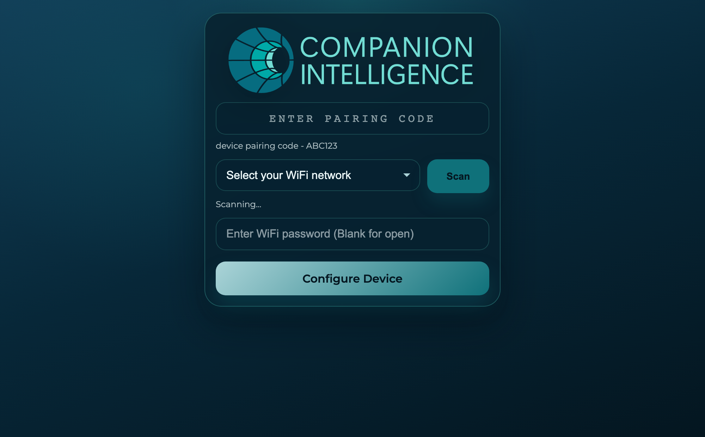
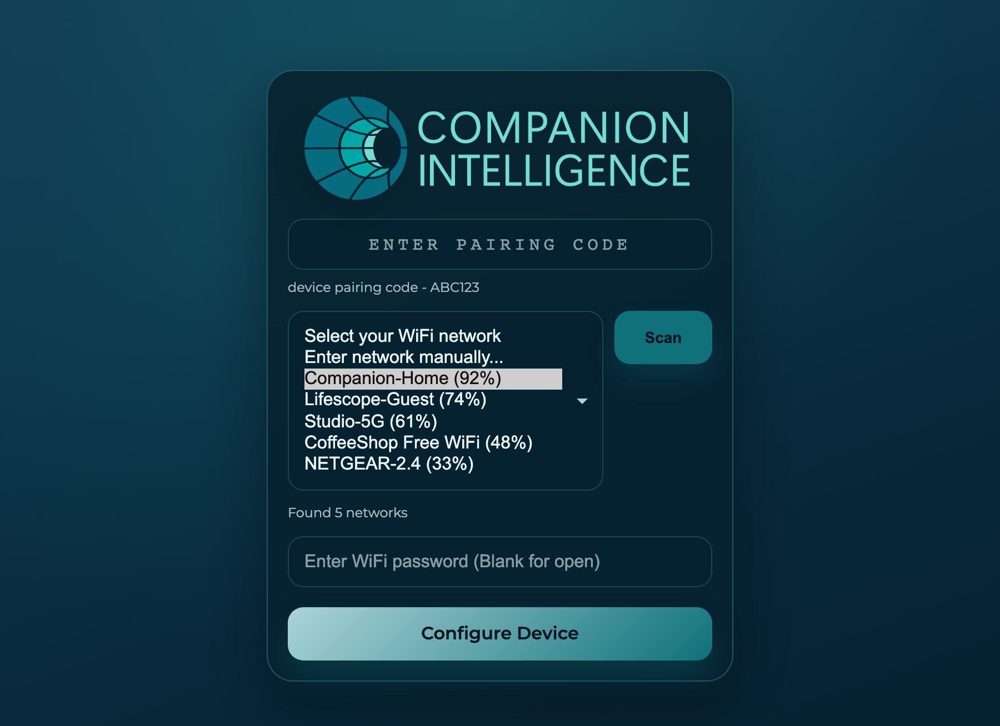
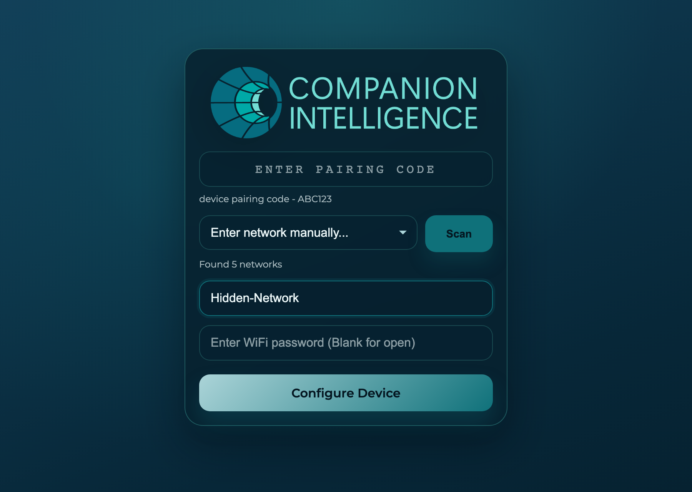
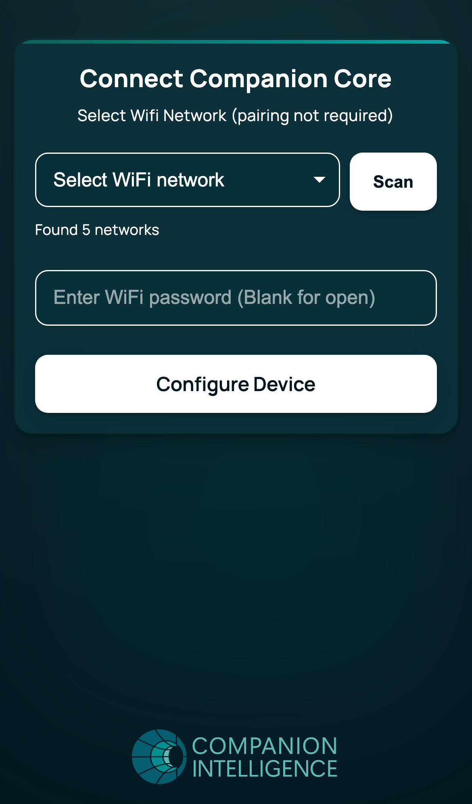
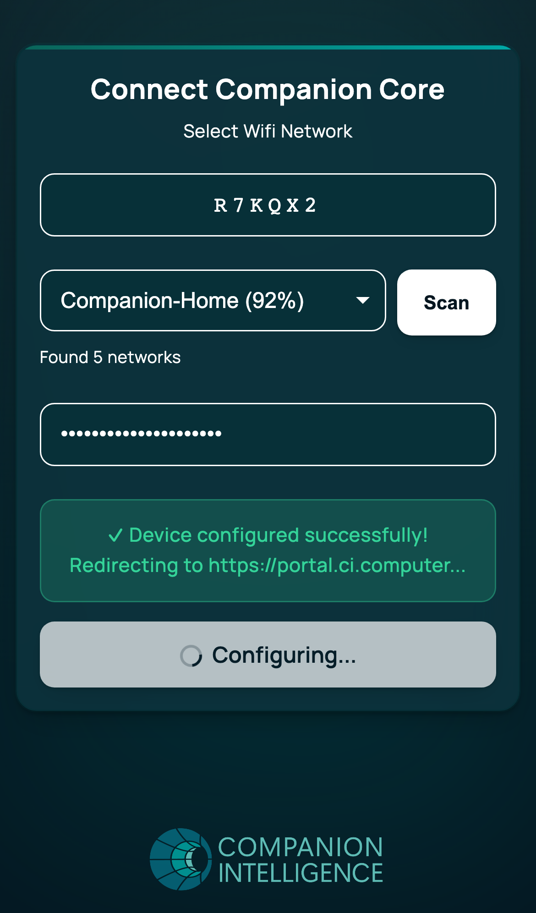
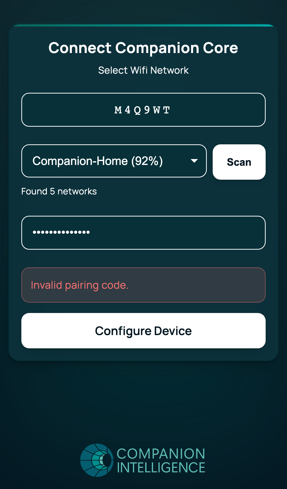

## Companion OS
### The Companion Intelligence appliance operating system, for Ubuntu 26.04 LTS and CachyOS


**© Companion Intelligence, Lifescope Inc**  
Companion OS uses the [PolyForm Noncommercial License 1.0.0](LICENSE.md). See the [License FAQ](License-FAQ.md).

---

## What Companion OS is

1. Companion OS is the operating system of the Companion Intelligence appliance: a private, local-first AI memory box that runs on an ordinary x86-64 PC.
2. It comes in two editions, both live-and-installer ISOs: one on **Ubuntu 26.04.1 LTS** (GNOME) and a **Plasma edition based on CachyOS**.
3. A first-boot step provisions Docker, Ollama with three local models, CI Hub and the network tools. A machine with no screen is reached through a Wi-Fi setup hotspot.
4. The **Companion Stick** (`ci-stick`) turns a USB stick into a bootable, verifiable carrier for the Ubuntu edition, its installers and its model packs.
5. This repository builds, themes, provisions and verifies all of it. No image is published yet, so you build one, and no run on real hardware is recorded.

Evidence tags used in this page: **[V]** verified (executed, result recorded), **[I]** implemented, not proven end to end, **[N]** not implemented.
The support policy and the full capability matrix are in [`docs/architecture/supported-targets.md`](docs/architecture/supported-targets.md).

## Contents

1. [The two editions side by side](#the-two-editions-side-by-side)
2. [Get an ISO](#get-an-iso)
3. [Make a Companion Stick](#make-a-companion-stick)
4. [Install](#install)
5. [First boot and hotspot setup](#first-boot-and-hotspot-setup)
6. [Models and model packs](#models-and-model-packs)
7. [Work on an existing machine (Ubuntu)](#work-on-an-existing-machine-ubuntu)
8. [Run the checks](#run-the-checks)
9. [Repo layout](#repo-layout)
10. [Status and evidence](#status-and-evidence)
11. [Documentation](#documentation)

---

## The two editions side by side

| | Ubuntu edition | Plasma edition (CachyOS base) |
|---|---|---|
| Base | The stock Ubuntu 26.04.1 LTS Desktop ISO, repacked. GNOME 50, one Wayland session. | The pinned CachyOS-Live-ISO profile (archiso) plus a Companion overlay. KDE Plasma 6. |
| Backend | `backends/ubuntu/` | `backends/cachyos/` (runs `backends/arch/` on first boot) |
| Image | `companion-os-<version>-amd64.iso`, 7,076,577,280 bytes in both full builds **[V]** | `companion-os-plasma-<YYYY.MM.DD>-x86_64.iso`, 3,217,129,472 bytes **[V]** |
| Build host | Ubuntu 26.04 as root; a privileged container on a Mac | Any host with Docker |
| Package source | Ubuntu archive at build time, vendor apt repositories with pinned keys | CachyOS and Arch repositories, rolling, on build day and again on install day |
| Installer | Canonical's installer, plus "Install Companion OS (automatic)" | Calamares, online only |
| One-click install | Yes **[I]**, 121 unit tests, not yet driven on a booted ISO | No **[N]** |
| Companion Stick boot | Yes. The stock 26.04.1 ISO boots from a stick under Secure Boot to early systemd **[V]**; a Companion image on a stick **[I]** | No **[N]**: the stick's boot menu is built for casper |
| Secure Boot | Inherited from the base ISO **[I]** | No **[N]**: unsigned GRUB and kernels |
| Hotspot setup | `setup-device` package, installed system **[I]** | Payload staged by the installer **[I]** |
| Models | Ollama baked in; models pulled at first boot **[I]** | Ollama installed by the installer; three models pulled at first boot **[V]** |
| Docker | Baked in, also in live sessions **[I]** | Installed system **[V]**; not on the live medium |
| GPU, ROCm | ROCm from the Ubuntu archive and Strix Halo boot parameters, Strix Halo class only **[I]** | Vulkan Ollama; ROCm only on request **[I]**; no boot parameters **[N]** |
| Status | Built from a clean checkout and statically verified (393 checks) **[V]**; a harness-assembled disk of the fix-pass image booted to the GDM greeter **[V]**; live session, installer runs and first boot pending | Live boot, install, installed boot and first boot ran end to end in QEMU twice (ISO #4, ISO #5) **[V]**, and ISO #5 shows the fixes of ISO #4's defects working **[V]**; the fix for the keyring step's 30 second limit **[I]** |

<!-- figure: docs/ui/companion-os/ubuntu/NN-live-grub-boot-menu.png -->
<!-- figure: docs/ui/companion-os/ubuntu/NN-live-desktop.png -->
<!-- figure: docs/ui/companion-os/plasma/NN-live-grub-boot-menu.png -->
<!-- figure: docs/ui/companion-os/plasma/NN-live-desktop.png -->

Caveats that apply to both: the shared setup portal is a stop-gap that needs a human security review; credentials found by the
2026-10-12 review are still to be rotated; model pulls have no disk-space guard. See
[`docs/architecture/known-issues-and-decisions.md`](docs/architecture/known-issues-and-decisions.md).

---

## Get an ISO

Neither edition has public hosting or a signing key holder yet **[N]**, so you build the image from this repository.

### Ubuntu edition

Needs Ubuntu 26.04 (resolute) with the Yaru theme installed, root, about 35 GB free and network access. `build-iso.sh` stops on any
other host. It repacks the stock Ubuntu 26.04.1 Desktop ISO: take the `.1` file, not the 26.04.0 image listed next to it.

```bash
sudo apt-get install squashfs-tools xorriso libglib2.0-bin libglib2.0-dev-bin yaru-theme-gnome-shell \
  rsync gpg cpio zstd initramfs-tools-core imagemagick librsvg2-bin curl

wget https://releases.ubuntu.com/26.04/ubuntu-26.04.1-desktop-amd64.iso
echo '601e30fbf5d97759367c632e2c33630665039b7e2158fd068403da3ccf1bda1f  ubuntu-26.04.1-desktop-amd64.iso' | sha256sum -c -

sudo ./backends/ubuntu/iso/scripts/build-iso.sh --base-iso ./ubuntu-26.04.1-desktop-amd64.iso
```

Output: `./output/companion-os-1.0-amd64.iso`, `SHA256SUMS`, `MD5SUMS`. Common flags: `--output-dir`, `--work-dir` (about 25 GB),
`--version`, `--skip-packages`, `--clean`, `--sign`. The full reference, the branding colour map and the iterative-development tips are
in [`backends/ubuntu/iso/README.md`](backends/ubuntu/iso/README.md) and the
[ISO build guide](docs/guides/iso-build-guide.md).

**On a Mac or any host that is not Ubuntu 26.04**, build inside a privileged container. On Apple silicon use an **ARM64**
`ubuntu:26.04` container: it is the route that produced the verified image, and the image's x86-64 chroot runs through the Docker VM's
Rosetta binfmt handlers. An amd64 `ubuntu:26.04` container may fail (GNU tar 1.35 reported "Function not implemented" under Rosetta once; the
trigger was not isolated), so it is not the recommended route. On an x86-64 Linux host drop `--platform linux/arm64`.

```bash
export ISO="$HOME/Downloads/ubuntu-26.04.1-desktop-amd64.iso"        # the 26.04.1 file, not the 26.04.0 image
export BUILD="$HOME/ci-os-build-tree"
echo '601e30fbf5d97759367c632e2c33630665039b7e2158fd068403da3ccf1bda1f  '"$ISO" | shasum -a 256 -c -
rm -rf "$BUILD" && mkdir -p "$BUILD" && git archive HEAD | tar -x -C "$BUILD"      # a clean tree of the commit you want to build
docker volume create ci-os-ubuild-vol
docker run -d --name ci-os-ubuild --privileged --platform linux/arm64 -v ci-os-ubuild-vol:/vol -v "$BUILD":/src:ro \
  -v "$ISO":/base/ubuntu-base.iso:ro -w /vol -e DEBIAN_FRONTEND=noninteractive ubuntu:26.04 sleep infinity
docker exec ci-os-ubuild bash -euc 'for i in $(seq 0 127); do [ -e /dev/loop$i ] || mknod -m 0660 /dev/loop$i b 7 $i; done; [ -e /dev/loop-control ] || mknod -m 0660 /dev/loop-control c 10 237'
docker exec ci-os-ubuild bash -euo pipefail -c 'apt-get update -qq && apt-get install -y -qq ca-certificates squashfs-tools xorriso rsync gpg curl cpio zstd initramfs-tools-core imagemagick librsvg2-bin libglib2.0-bin libglib2.0-dev-bin yaru-theme-gnome-shell python3 python3-yaml diffutils mount util-linux file'
docker exec ci-os-ubuild bash -euc 'mkdir -p /vol/repo /vol/work /vol/out /vol/cache && rsync -a --delete /src/ /vol/repo/'
caffeinate -i docker exec -e CI_OS_CACHE_DIR=/vol/cache -w /vol/repo ci-os-ubuild ./backends/ubuntu/iso/scripts/build-iso.sh \
  --base-iso /base/ubuntu-base.iso --output-dir /vol/out --work-dir /vol/work --version 1.0 --clean 2>&1 | tee build.log
docker exec -e VERIFY_BASE_ISO=/base/ubuntu-base.iso -e VERIFY_REQUIRE_CANON=1 -w /vol/repo ci-os-ubuild ./backends/ubuntu/iso/scripts/verify-iso.sh /vol/out/companion-os-1.0-amd64.iso
mkdir -p output && docker cp ci-os-ubuild:/vol/out/. ./output/
docker rm -f ci-os-ubuild && docker volume rm ci-os-ubuild-vol
```

The same commands, with the reasons for each step, are in [`docs/guides/building-on-a-mac.md`](docs/guides/building-on-a-mac.md#recipe);
`CLAUDE.md` carries the same block, and the three are changed together. Never run systemd as PID 1 in that container (it wipes the Docker
VM's Rosetta registrations; restart Docker Desktop to recover), and keep more than 40 GiB free on the Data volume.
[`.github/workflows/build-companion-os-iso.yml`](.github/workflows/build-companion-os-iso.yml) does the same in CI, in a privileged
`ubuntu:26.04` container, and is manual-only.

### Plasma edition (CachyOS base)

Needs Docker, bash 3.2 or newer, network, and about 25 GiB free in the Docker VM plus about 3 GB for the output.

```bash
backends/cachyos/iso/scripts/build-iso.sh --version 1.0
```

Output in `output/`: `companion-os-plasma-<YYYY.MM.DD>-x86_64.iso`, `.iso.sha256`, `.pkgs.txt` (the package list), `.build-info`
(pins, hashes, whether the tree was clean) and `.build.log`. The build packs the **working tree**, not a commit; add
`--require-clean` for a release. Flags and pins: [`backends/cachyos/README.md`](backends/cachyos/README.md).

### Verify an image

```bash
# Ubuntu: no root needed to read an image (xorriso, squashfs-tools, zstd, cpio, python3)
VERIFY_BASE_ISO=./ubuntu-26.04.1-desktop-amd64.iso backends/ubuntu/iso/scripts/verify-iso.sh output/companion-os-*.iso

# Plasma: in the builder image, the ISO mounted read-only
IMAGE="$(docker images --format '{{.Repository}}:{{.Tag}}' ci-os-cachyos-builder | head -n 1)"
docker run --rm --platform linux/amd64 --cpus 4 --memory 8g -v "$PWD:/repo:ro" -v "$PWD/output:/iso:ro" "$IMAGE" bash -c '
  VERIFY_FETCH_UPSTREAM=1 /repo/backends/cachyos/iso/scripts/verify-iso.sh "$(ls /iso/companion-os-plasma-*-x86_64.iso | head -n 1)"'
```

### Measured so far

| | Ubuntu 26.04.1 | Plasma |
|---|---|---|
| Build time | **772 s** (12 min 52 s) from a clean checkout at `02c575e`; 860 s for the earlier build of a worktree snapshot during the fix pass. Both had every optional bake on and ran in a privileged ARM64 `ubuntu:26.04` container on an Apple-silicon Mac | 25 to 26 minutes under Rosetta on a lightly loaded Mac (ISO #4 26 min, ISO #5 25 min); 31 to 37 minutes on a loaded one; upstream's own CI needs about 18 minutes on a native runner |
| Image size | 7,076,577,280 bytes (6.59 GiB); the Stick slot of a 64 GB stick is 8 GiB and `verify-iso.sh` fails above it | 3,217,129,472 bytes (3.0 GiB) |
| Static verification | 393 passed, 0 failed, 0 skipped in 34 s, on the clean-checkout image **[V]** | 187 passed, 0 failed on ISO #2 **[V]**; the verifier has grown since, and no log of ISO #4 or #5 was kept |
| Still to measure | A boot of the clean-checkout image (test-evidence U2 to U11) | A `verify-iso.sh` run on ISO #5 |

The records of the 772 s build (build record, exit status, verifier log) and of the 860 s build's boot and verify are in
[`docs/evidence/`](docs/evidence/README.md); the transcript of the 860 s build is not in the repository. The Plasma times are from
`docs/architecture/cachyos-backend.md`.

---

## Make a Companion Stick

`ci-stick` (Rust, `stick/`) builds and verifies a signed bundle, plans the partition layout, flashes a stick or a sparse stick image
(Ubuntu x86_64 layout, A/B boot slots, persistence) and manages model packs. A stick boots the **Ubuntu** edition through the
signed chain shim, Canonical GRUB, Canonical kernel. It cannot boot the Plasma edition **[N]**. Rust 1.75 or newer is needed.

```bash
(cd stick && cargo build --release) && export PATH="$PWD/stick/target/release:$PATH"
ci-stick layout plan --size 64GB             # 1 GiB EFI, 4 GiB shared, 8 GiB slots A and B, 30 GiB cache, ~8.6 GiB persistence
ci-stick models list                         # the model-pack catalog (core/manifest/model-packs.yaml)

# Stage: boot/ is the ISO, efi/ the signed boot chain (installers/, oci/, models/, docs/, tools/ are optional)
mkdir -p staging/boot staging/efi && cp output/companion-os-1.0-amd64.iso staging/boot/
stick/scripts/fetch-signed-boot.sh ./signed-boot                  # shim, Canonical GRUB, MokManager from the resolute archive (needs apt on Ubuntu 26.04)
cp ./signed-boot/{shimx64,grubx64,mmx64}.efi staging/efi/
ci-stick lock ./staging --id companion-stick-ubuntu --version 2026.10.0 --size 64GB --packs core/manifest/model-packs.yaml
ci-stick dev keygen --out ./dev && ci-stick dev sign ./staging --key ./dev.key     # development key; release bundles are signed by the release pipeline
ci-stick verify ./staging --pubkey ./dev.pub

# Flash: ALWAYS a dry run first. --device ERASES the whole device.
ci-stick flash ./staging --pubkey ./dev.pub --image stick.img --size 64GB --dry-run
sudo ci-stick flash ./staging --pubkey ./dev.pub --device /dev/disk/by-id/usb-XYZ --dry-run

# Slots: A/B pointer in ci-stick/grubenv on the EFI volume
ci-stick slot show --image stick.img
ci-stick slot set B --image stick.img
```

Without Secure Boot (development only), `stick/scripts/build-grub-efi.sh` builds an unsigned GRUB instead of the signed chain.
`ci-stick flash` writes only to removable or USB disks with nothing mounted, refuses the system disk and re-checks the device's
identity before the first write; you are still the last check. Device writes are Linux-only. Evidence: `stick/tests/qemu/run.sh`
(17 PASS lines: three boots, persistence, slot B, a tampered bundle, device-safety refusals) and the Secure Boot A, B, C run
(`stick/tests/secureboot/run-on-mac.sh`, 8 checks) pass **[V]**; no write to physical media has been exercised **[N]**. Full
usage and exit codes: [`stick/README.md`](stick/README.md). Architecture and trust model:
[`docs/architecture/companion-stick.md`](docs/architecture/companion-stick.md).

---

## Install

Both ISOs are hybrid images: write one to a USB stick (`dd`, an imaging tool, or `ci-stick` for the Ubuntu edition) or attach it to a
virtual machine, and boot it. The Plasma edition needs Secure Boot off.

### Ubuntu edition

The GRUB menu has two entries: **Try or Install Companion OS** and **Install Companion OS (automatic)**.

* **One-click.** Pick the automatic entry, or click "Install Companion OS (automatic)" on the live desktop. One dialog names the target
  disk (model, size, device node and everything found on it) and the disks it will leave alone, and shows a one-time password for the
  user `companion`. Enter never confirms; the default is **Cancel**. After the click a progress window follows the installer, the
  computer turns off when it is done, and the first sign-in forces a new password. The tool never offers the boot medium, a removable
  disk or one under 25 GB. Safety rules, state machine and tests: [`docs/architecture/one-click-install.md`](docs/architecture/one-click-install.md).
  Status **[I]**: unit-tested, not yet driven on a booted image.
* **Interactive.** Pick the first entry and use Canonical's installer. Its window keeps Ubuntu's own text (it is a Canonical snap); the
  launcher label and the last page read "Companion OS".

### Plasma edition

1. Boot **Companion OS (Plasma)**. On a software-emulated VM the desktop takes about 4 minutes to its first frame **[V]**.
2. Open the application menu and start **Install Companion OS**. The launcher first makes sure the pacman keyring works, checks the
   installer package against its guards, applies the Companion overlay and runs a package preflight (about 3 minutes **[V]**), then
   opens Calamares. The install is **online only**: it needs a working internet connection.
3. Calamares pages: Welcome, Location, Keyboard, Bootloader (GRUB only), Partitions, Packages, Users, Summary, Install, Finish.
4. The install took 22 min 9 s for 47 jobs on a 30 GiB virtual NVMe in QEMU (ISO #4) and 23 min 20 s on a 64 GiB one (ISO #5) **[V]**. On
   ISO #5 two of three attempts died at 2 percent with "create-pacman-keyring failed to finish in 30 seconds" on the slow emulated host; if you see
   that dialog, close it and start the installer again (KI-20, a fix is in the working tree **[I]**). Restart, remove the medium.

<!-- figure: docs/ui/companion-os/plasma/NN-live-calamares-welcome.png -->
<!-- figure: docs/ui/companion-os/ubuntu/NN-install-one-click-confirmation.png -->

Disk size: the installed system takes about 7.9 GiB and the model set adds about 18.8 GB (a 30 GiB disk ended 88 % full). Give the
Plasma edition 64 GiB or more. Step-by-step instructions, recovery and troubleshooting:
[`docs/guides/installation-guide.md`](docs/guides/installation-guide.md).

---

## First boot and hotspot setup

**First boot.** A systemd unit runs the provisioner on the installed system until it has succeeded once, at every boot and every
15 minutes while pending (an offline first boot just waits for the network), with at most three failed automatic runs.

| | Ubuntu | Plasma |
|---|---|---|
| Units | `ci-os-first-boot-rebrand.service`, `ci-os-first-boot-setup.service` and its timer | `ci-os-first-boot-setup.service` and its timer (`Type=exec`, so the boot targets do not wait for it) |
| Runs | `backends/ubuntu/provision/provision.sh --tier=core` | the wrapper `backends/cachyos/provision/provision.sh`, which runs `backends/arch/provision/provision.sh --tier=core` |
| Result | a marker file on success | `/var/lib/ci-os/first-boot-setup-status`; a missing model is "degraded" (exit 74) and is retried |
| Re-run | `sudo ci-os-setup` | `sudo ci-os-setup` (add `--tier=core,hardware` for ROCm and LACT) |

The `extended` tier (VS Code, Chromium, Homebrew, Companion Launcher) is never run at first boot. The Plasma first boot with a
network took 16 min 4.6 s to pull the three models in the ISO #4 run, and ended "degraded" because of a defect (`ollama list` ran
without `$HOME`). Commit `552063f` fixes it, and on ISO #5 the same step took 21 min 49 s, ended with status 0, wrote its marker and
reported no "degraded" **[V]**.

**Hotspot (headless setup).** A device with no screen reaches your Wi-Fi through a captive portal. When both Ethernet and Wi-Fi are
down, `setup-network-monitor.service` starts an access point named `Companion-Setup-XXXX` (the suffix is random per start). Connect,
open `http://192.168.99.1` (or `http://setup.ci.computer`), choose a network, enter its password and the pairing code, and the
device joins your network and stops the hotspot.

| Item | Value |
|---|---|
| Gateway, DHCP range | 192.168.99.1, 192.168.99.10 to 192.168.99.250 |
| Pairing code | `/etc/setup-device/pairing_code.json` (root only; the backend creates it on its first request) |
| AP passphrase | the shared default in `core/headless/payload/hostapd/hostapd-setup.conf` (a known weakness) |
| Key paths | backend `/opt/setup-backend/setup_service.py`, portal `/var/www/setup-portal/`, state in `/var/lib/setup-device/` |
| Start it again | the monitor starts the hotspot whenever there is no connectivity: take the network down (`sudo nmcli connection down --active`) and wait; it checks about every 3 s and acts after two failed checks past a 45 s grace |
| Build the Ubuntu package alone | `cd backends/ubuntu/headless-package && ./build.sh && sudo dpkg -i setup-device_*.deb` |

The portal API has no local authentication (audit findings S1 and S2), and the access point uses a shared passphrase. The stop-gap
fixes landed in `b882e00`; a human security review is required, and a tested replacement library (`core/headless/ci_setup/`) exists
but is not wired into any service. Details, the 51-defect audit and the threat model:
[`docs/architecture/headless-setup.md`](docs/architecture/headless-setup.md). Status **[I]**: the units are present on the
installed Plasma system **[V]**, but no access point has been brought up on a real radio **[N]**.

<table>
<tr>
<td align="center"><br>First-boot form</td>
<td align="center"><br>Network scan</td>
<td align="center"><br>Manual entry</td>
</tr>
<tr>
<td align="center"><br>No-pairing variant</td>
<td align="center"><br>Success</td>
<td align="center"><br>Error</td>
</tr>
</table>

The portal is a single-theme (dark) captive page built on the Companion Intelligence design tokens and the self-hosted Manrope font
(`vendor/brand/`). The screens were rendered offline from `core/headless/payload/var/www/setup-portal/` with Playwright at phone width,
the backend responses stubbed only to trigger the portal's own render paths; nothing is hand-drawn.

### What a printed QR code may carry

No sticker ships today. A QR printed on an appliance cannot rotate and cannot expire: whatever is in the ink stays valid for the life of
the box, on every unit of the run, readable by anyone who sees the case.

* **It may carry** a non-secret per-unit serial and a Portal claim URL for that serial (`https://portal.companionintelligence.com/...`).
* **It must not carry** a long-lived key, token or device secret; Wi-Fi credentials (the setup hotspot passphrase is a shared default,
  and printing it would make that default physically permanent for the whole fleet); anything still valid after the first claim.
* **Do not ship a hotspot QR until the SSID is per-device.** `device.conf` reserves `SERIAL_SUFFIX` for this and nothing reads it
  yet; the live SSID suffix is random on every start, so no label can name the network it should join.
* **Always print the URL in readable text beside the code**, on a domain the user can verify by eye. A QR is opaque, and a sticker
  placed over ours redirects the scan unnoticed ("quishing"); legible text is what lets a user see the destination is wrong.

Changing the hostapd defaults is a separate product decision with fleet implications and is not made here.

---

## Models and model packs

`core/manifest/ecosystem.yaml` fixes the appliance's model set: `nomic-embed-text`, `gemma3:1b` and `qwen3.6:27b` (the pack
`appliance-core`, 18.8 GB; `qwen3.6:27b` alone is 17.8 GB). The set is pulled at first boot and never baked into an image. The Ubuntu
edition pulls `qwen3.6:27b` only on a Strix Halo class machine, and then the RAM and GPU-memory gate `ci_os_model_gate_allows`
(`core/lib/gpu-detect.sh`) applies on top. The Plasma edition relies on that gate alone, and on an installed system it has no data
(`model-packs.yaml` is not staged), so all three models are pulled on every machine **[N]**. **No guard checks the free disk space
either [N]**; both are tracked as KI-01 in [Known issues and decisions](docs/architecture/known-issues-and-decisions.md).

For sticks and offline use, `ci-stick models` manages a content-addressed Ollama-format cache on the stick's `CI-CACHE` volume. Digests
come from the registry, are written to `core/manifest/model-packs.lock.json` and are never typed by hand:

```bash
ci-stick models list --fits 300GiB                                   # which packs fit a cache of that size
ci-stick models lock                                                 # maintainers: resolve the catalog against the registry (network)
ci-stick models plan --pack stick-128 --cache /Volumes/CI-CACHE      # cost and fit, no network
ci-stick models fetch --pack stick-128 --cache /Volumes/CI-CACHE     # resumable, SHA-256 verified; run again after any interruption
ci-stick models cache-info --cache /Volumes/CI-CACHE
```

On a running Companion OS, `ci-os-models` (`core/lib/ci-os-models.sh`) decides where the cache is, what the consumers need in their
environment (Ollama, Hugging Face tools, llama.cpp), whether the machine can run a model, and, opt-in, when a background prefetch may
run. Design and status: [`docs/architecture/models-tooling.md`](docs/architecture/models-tooling.md),
[`docs/architecture/model-packs-128gb.md`](docs/architecture/model-packs-128gb.md).

---

## Work on an existing machine (Ubuntu)

Without reimaging, the Ubuntu backend's scripts convert a machine you already have. The provisioning, bootstrap and theme scripts are idempotent, so a failed run can simply be run again.

| Goal | Entry point | Run on |
|---|---|---|
| Ship a branded installer ISO | `backends/ubuntu/iso/scripts/build-iso.sh` | An Ubuntu 26.04 build host or container |
| Provision the appliance stack | `sudo backends/ubuntu/provision/provision.sh --tier=core,extended,hardware` | The target, as root |
| One command for a freshly flashed Ubuntu 26.04 | `sudo backends/ubuntu/provision/bootstrap-ci-os.sh --yes` (provision, rebrand, headless package; `--no-headless`, `--no-rebrand`, `--no-reboot`) | The target |
| Re-skin a running GNOME desktop, no packages | `sudo backends/ubuntu/desktop-theme/apply-ci-os-desktop.sh` (`--wizard`, `--only plymouth,dconf`, `--validate`) | The target |
| Build the headless setup package | `backends/ubuntu/headless-package/build.sh` | Anywhere with `dpkg-deb` |

`provision.sh --tier=` takes a comma list of `core`, `extended`, `hardware` (default `core,hardware`). The `hardware` tier acts only on a
Strix Halo class machine (Ryzen AI Max, gfx1151 or Radeon 8060S, at least about 32 GB of RAM): it installs ROCm and LACT from the Ubuntu
26.04 archive and the inbox amdgpu driver, and adds `iommu=pt amdgpu.gttsize=<N> ttm.pages_limit=<M>` to the kernel command line
so the amdgpu driver can address most of system RAM as GPU-visible memory, which is needed for local-LLM/ROCm/Vulkan workloads on
these unified-memory APUs (a reboot is needed; set the BIOS integrated-graphics memory to its smallest option). Anywhere else it
changes nothing. The theme
steps run in a fixed order: plymouth, grub, dconf, terminal, wallpaper, session, start-icon, about-logo, os-release, names, motd. Palette and
assets: [`assets/branding/brand-guidelines.md`](assets/branding/brand-guidelines.md). `pull-dev-manual.sh` at the root is a thin
wrapper around `core/lib/ci-hub.sh` for manual CI-Hub deploys: inputs, ports and the security notes are in the
[CI-Hub deploy guide](docs/guides/ci-hub-deploy.md).

On the Plasma edition the first-boot unit provisions the machine; `sudo ci-os-setup` re-runs it.

---

## Run the checks

```bash
./core/lib/check-repo.sh                                                   # the fast gate; about 6 minutes on a loaded laptop
(cd stick && cargo fmt --check && cargo clippy --all-targets -- -D warnings && cargo test)   # the "stick" job
stick/tests/qemu/run.sh                                                    # Stick flash and boot in QEMU (TCG works without /dev/kvm)
```

`check-repo.sh` needs `git`, `shellcheck`, `python3` with PyYAML and `yamllint` (macOS: `brew install shellcheck yamllint`). It runs
bash syntax and `shellcheck -S error`, `py_compile`, `yamllint`, the retired-name guards (`core/lib/retired-names.allow`), the
untracked-file guard (`core/lib/check-untracked-deps.sh`), and the fast suites of both backends, the setup payload and the model
tools. A suite that needs a missing tool exits 2 and is reported "cannot run here". `git add` a new file before you trust it. The
container, QEMU and network suites are manual. [Running the tests](docs/guides/running-the-tests.md) lists every suite, what it needs and which one
to run for the change you made; the detailed tables are in [`backends/ubuntu/iso/README.md`](backends/ubuntu/iso/README.md)
("Script tests") and [`backends/cachyos/README.md`](backends/cachyos/README.md) ("Tests"). The workflows in `.github/workflows/` are
manual-only (`ci-local:gated`); [`docs/CI.md`](docs/CI.md) explains how to start a gated workflow with `gh workflow run`.

---

## Repo layout

```
.
├── CLAUDE.md, AGENTS.md, ANTIGRAVITY.md, opencode.json, .github/copilot-instructions.md   agent guides (CLAUDE.md is canonical)
├── .claude/              settings, session-start hook, skills/steward (PR conventions)
├── .github/workflows/    build-companion-os-iso.yml, pr-checks.yml, stick-real-iso.yml, style-canon-lint.yml (manual-only)
├── core/                 distro-portable: no package-manager assumptions
│   ├── manifest/         ecosystem.yaml, role-map/{apt,pacman}.yaml, model-packs.yaml + lock, tier-b-pins.env, licenses.yaml
│   ├── render/           tokens + assets -> GRUB background, MOTD, mark PNGs, GNOME Shell gresource; inputs/, tests/
│   ├── lib/              theme-lib.sh, gpu-detect.sh, ci-os-models.sh, ci-hub.sh, vendor-brand.sh, check-repo.sh, retired-names.allow, tests/
│   └── headless/         payload/ (setup backend, portal, hostapd/dnsmasq/nginx, units), ci_setup/ (tested library), tests/
├── backends/
│   ├── ubuntu/           Companion OS on Ubuntu 26.04.1: apt/dpkg + Bash
│   │   ├── iso/          scripts/ (build-iso.sh, verify-iso.sh, md5sum-txt.sh, lib/split-live-layer.sh, gresource builder), tests/, README.md
│   │   ├── chroot/       customize-chroot.sh, payload/ (apt, docker, live-start = one-click installer, models, ssh), tests/
│   │   ├── provision/    provision.sh, bootstrap-ci-os.sh, install-models.sh
│   │   ├── desktop-theme/  apply-ci-os-desktop.sh + plymouth, grub, wallpaper, start-icon, about-logo, os-release, names steps; tests/
│   │   ├── lib/          os-release writer, ROCm and LACT installers, telemetry removal, Strix Halo boot parameters
│   │   ├── packages/     ci-os-branding (GNOME Shell theme .deb sources)
│   │   └── headless-package/  build.sh, DEBIAN/, netplan/ (apt packaging of the setup payload)
│   ├── cachyos/          Companion OS on CachyOS: pinned archiso profile + overlay, built in a container
│   │   ├── iso/          scripts/ (build-iso.sh, in-container engine, verify-iso.sh), overlay/, docker/, tests/
│   │   ├── installer/    Calamares overlay: settings, modules, branding, guards, scripts
│   │   ├── provision/    first-boot wrapper, systemd units, progress filter, setup-portal stager
│   │   └── upstream.lock, compat-libs.lock, NOTICE, README.md
│   ├── arch/             NOT a target: the frozen pacman engine under CachyOS (provision/, headless-setup/ oracle, desktop-theme/ unused)
│   └── _mixins/          gnome-dconf/ (Ubuntu), kde-plasma/ (CachyOS)
├── stick/                Rust workspace: crates/ci-stick, schema/, scripts/ (signed-boot fetch, GRUB), tests/{qemu,secureboot}
├── vendor/brand/         the pinned brand bundle (ci-brand 1.0.0): tokens, logos, Manrope font; SHA256SUMS
├── assets/               logos, wallpaper, branding/brand-guidelines.md, GNOME Shell theme assets
├── docs/                 README.md (index), architecture/, guides/, evidence/ (text records behind the verified rows), plans/, ui/, CI.md
├── pull-dev-manual.sh    thin wrapper around core/lib/ci-hub.sh
└── LICENSE.md, License-FAQ.md, NOTICE.md, THIRD_PARTY.md, CREDITS.md
```

---

## Status and evidence

As of 2026-10-18 (branch `liam/companion-os-single-click-install`, local commits only). The columns say what was run, not
what is intended. The sources and the pending items are in [`docs/architecture/test-evidence.md`](docs/architecture/test-evidence.md)
and [`docs/architecture/supported-targets.md`](docs/architecture/supported-targets.md).

| Area | Ubuntu 26.04.1 | Plasma (CachyOS) |
|---|---|---|
| Build | **[V]** clean checkout at `02c575e`, 772 s; fix-pass snapshot, 860 s | **[V]** five ISOs |
| Static verifier | **[V]** 393 passed, 0 failed (both images) | **[V]** 187 passed on ISO #2; no log of ISO #4 or #5 |
| Live session boots | GRUB menu under Secure Boot **[V]** (fix-pass image); GNOME desktop pending | **[V]** to the Plasma desktop under QEMU/OVMF |
| Install to disk | pending; a harness-assembled disk of the fix-pass image (version 9.9, `dce9eb71...`, not a commit) booted to the GDM greeter in 230 s **[V]**; the clean-checkout image (`709b8485...`) has only the `--no-boot` checks | **[V]** ISO #4 22 min 9 s; ISO #5 23 min 20 s on its third attempt (two failed at the 30 s keyring limit, KI-20) |
| First boot and models | pending | **[V]** ISO #4: models pulled in 16 min, ended "degraded" (defect); ISO #5: 21 min 49 s, status 0, no "degraded" |
| Stick boot | stock ISO under Secure Boot to early systemd **[V]** | **[N]** |
| Real hardware | **[N]** | **[N]** |

Pending evidence: for the Ubuntu 26.04.1 image the live session, both installers, the boot of the clean-checkout image and first boot
(test-evidence rows U2 to U11), and for Plasma a `verify-iso.sh` log and a run of the keyring-step fix. Each row says what confirms it in
[`test-evidence.md`](docs/architecture/test-evidence.md); [`supported-targets.md`](docs/architecture/supported-targets.md) maps the matrix to those rows.

Retired on 2026-10-17 (restore tag `pre-retire-multidistro-2026-10-17`): Ubuntu 24.04, Linux Mint, Fedora, Bazzite and NixOS.

---

## Documentation

The index of every document is [`docs/README.md`](docs/README.md). Start here:

* [Supported targets](docs/architecture/supported-targets.md): policy, capability matrix, retirement and restore.
* [Core and backends design](docs/architecture/multi-distro-design.md): how the repository is organised.
* [Known issues and decisions](docs/architecture/known-issues-and-decisions.md), [Test evidence](docs/architecture/test-evidence.md) and
  the [evidence records](docs/evidence/README.md).
* Building and installing: [ISO build guide](docs/guides/iso-build-guide.md), [Installation guide](docs/guides/installation-guide.md),
  [Quick start](docs/guides/quick-start-guide.md), [Building on a Mac](docs/guides/building-on-a-mac.md),
  [Testing in QEMU](docs/guides/testing-in-qemu.md), [Running the tests](docs/guides/running-the-tests.md),
  [Release checklist](docs/guides/release-checklist.md), [CI-Hub deploy](docs/guides/ci-hub-deploy.md),
  [Environment reference](docs/guides/environment-reference.md).
* Per edition: [`backends/ubuntu/iso/README.md`](backends/ubuntu/iso/README.md), [`backends/cachyos/README.md`](backends/cachyos/README.md),
  [Ubuntu ISO layers](docs/architecture/ubuntu-iso-layers.md), [CachyOS backend](docs/architecture/cachyos-backend.md).
* Stick and models: [`stick/README.md`](stick/README.md), [Companion Stick](docs/architecture/companion-stick.md),
  [Models tooling](docs/architecture/models-tooling.md).

## Support

* **Issues**: https://github.com/companionintelligence/CI-OS/issues
* **Website**: https://ci.computer

© Companion Intelligence, Lifescope Inc
