# CI-OS Architecture

## Executive Summary

This repository is a build and provisioning system for CI-OS, an Ubuntu 24.04 based operating system distribution. It contains:

- ISO remastering scripts that convert a stock Ubuntu Desktop ISO into a CI-OS installer ISO.
- Chroot customization logic that brands the live/install image and installs first-boot services.
- Debian package sources for CI-OS branding, base system metadata, keyring setup, and future companion services.
- Existing-system setup scripts for Ubuntu machines.
- Desktop branding scripts for GNOME, GDM, Plymouth, KDE, MOTD, wallpaper, and OS identity.
- A headless setup package that creates a WiFi hotspot and captive portal for first-time network configuration.
- GitHub Actions automation for repeatable ISO builds and release artifacts.

The repo is best understood as OS image infrastructure, not an app backend or frontend project.

---

## System Map

```mermaid
flowchart TB
    repo["CI-OS repository"]

    repo --> iso["ISO build pipeline"]
    repo --> packages["Debian package sources"]
    repo --> branding["Installed-system branding"]
    repo --> fresh["Fresh Ubuntu setup"]
    repo --> headless["Headless setup device package"]
    repo --> docs["Operator documentation"]
    repo --> ci["GitHub Actions CI/CD"]

    iso --> buildIso["tools/iso-build/scripts/build-iso.sh"]
    iso --> chroot["scripts/customize-chroot.sh"]
    iso --> outputIso["output/companion-os-<version>-amd64.iso"]

    packages --> brandingPkg["ci-os-branding"]
    packages --> basePkg["companion-os-base"]
    packages --> keyringPkg["companion-os-keyring"]
    packages --> placeholderPkgs["companion-agents / companion-memory"]

    branding --> desktopEntry["setup/os-changes/apply-ci-os-desktop.sh"]
    fresh --> ubuntuSetup["scripts/setup-fresh-ubuntu.sh"]
    headless --> setupDeb["setup-device_<version>_amd64.deb"]
    ci --> release["Release artifacts and checksums"]
```

---

## Build-Time Architecture

The ISO builder preserves the Ubuntu installer's expectations while changing the visible operating system identity and bundled configuration.

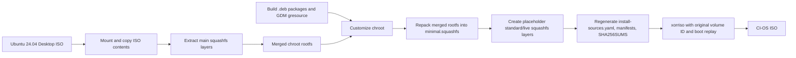

### ISO Build Sequence

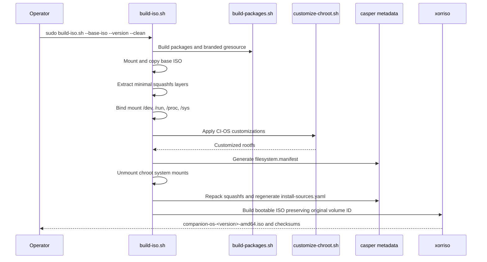

### Why Ubuntu Identity Is Preserved During Install

`scripts/customize-chroot.sh` intentionally keeps:

| File | Installer-Compatible Value | Reason |
|---|---|---|
| `/etc/os-release` | `ID=ubuntu`, `VERSION_ID=24.04` | Subiquity and curtin expect Ubuntu IDs for APT, curthooks, GRUB, initramfs, and snap seeding |
| `/etc/lsb-release` | `DISTRIB_ID=Ubuntu`, `DISTRIB_RELEASE=24.04` | Installer tooling and package logic rely on Ubuntu release values |
| Visible branding | `NAME="CI-OS"`, `PRETTY_NAME="CI-OS <version>"` | Users still see CI-OS branding during live/install use |

After installation, `ci-os-first-boot-rebrand.service` rewrites identity files to true CI-OS values on the first boot of the installed system.

---

## Runtime Architecture After Install

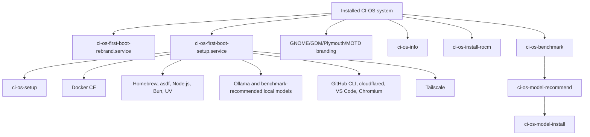

### Installed System Components

| Component | Installed By | Purpose |
|---|---|---|
| `ci-os-first-boot-rebrand.service` | `customize-chroot.sh` | Rewrites Ubuntu-compatible identity to CI-OS after install |
| `ci-os-first-boot-setup.service` | `customize-chroot.sh` | Installs developer, AI, and networking tools after first boot |
| `ci-os-setup` | `customize-chroot.sh` | Manual rerun wrapper for first-boot setup |
| `ci-os-info` | `customize-chroot.sh` | Prints OS, kernel, AMD GPU, and ROCm status |
| `ci-os-install-rocm` | `customize-chroot.sh` | Adds ROCm repo and installs AMD ROCm components |
| `ci-os-benchmark` | `scripts/ci-os-ai-setup.sh` via `customize-chroot.sh` | Writes hardware and Ollama readiness data to `benchmark.json` |
| `ci-os-model-recommend` | `scripts/ci-os-ai-setup.sh` via `customize-chroot.sh` | Chooses a conservative Ollama model set for the device |
| `ci-os-model-install` | `scripts/ci-os-ai-setup.sh` via `customize-chroot.sh` | Pulls recommended Ollama models, with optional larger models behind a flag |
| GNOME/GDM resource | `ci-os-branding` and chroot customization | Rebrands login shell resources |
| MOTD and issue banners | `customize-chroot.sh` and branding scripts | CLI identity and login messaging |

---

## AI Express Setup Architecture

The current implementation adds the benchmark and model recommendation layer that future Express Setup can call. It avoids hardcoding a single large model for every machine and instead writes machine-readable output for UI, logs, or a setup portal.

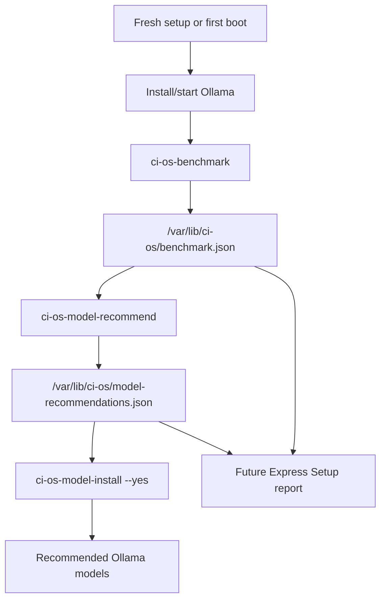

### Benchmark Signals

| Signal | Source | Used For |
|---|---|---|
| CPU model | `/proc/cpuinfo` | Human-readable report |
| CPU cores | `nproc` | Future throughput expectations |
| RAM | `/proc/meminfo` | Primary model-size tiering |
| Root disk free | `df -Pk /` | Suppress optional models on tight disks |
| GPU summary | `lspci` | Detect AMD, NVIDIA, Intel, or no GPU |
| VRAM | `rocm-smi` or `nvidia-smi` when available | Optional vision/larger-model hints |
| Ollama readiness | `ollama list` | Decide whether model install can proceed |

### Recommendation Policy

| Tier | Rule | Default Models |
|---|---|---|
| Small | Less than 12 GB RAM | `nomic-embed-text`, `gemma3:1b`, `qwen2.5:1.5b` |
| Balanced | 12-23 GB RAM | `nomic-embed-text`, `gemma3:1b`, `llama3.2:3b`, `qwen2.5:3b` |
| Workstation | 24-47 GB RAM | `nomic-embed-text`, `gemma3:1b`, `llama3.1:8b`, `qwen2.5:7b` |
| Large | 48 GB+ RAM | `nomic-embed-text`, `gemma3:1b`, `llama3.1:8b`, `qwen2.5:14b` |

Optional models are only installed when an operator explicitly passes `--include-optional`.

### Express Setup Next Step

The next implementation layer should introduce `ci-os-express-setup` as an orchestrator instead of adding more logic directly into `setup-fresh-ubuntu.sh` or the generated first-boot script.

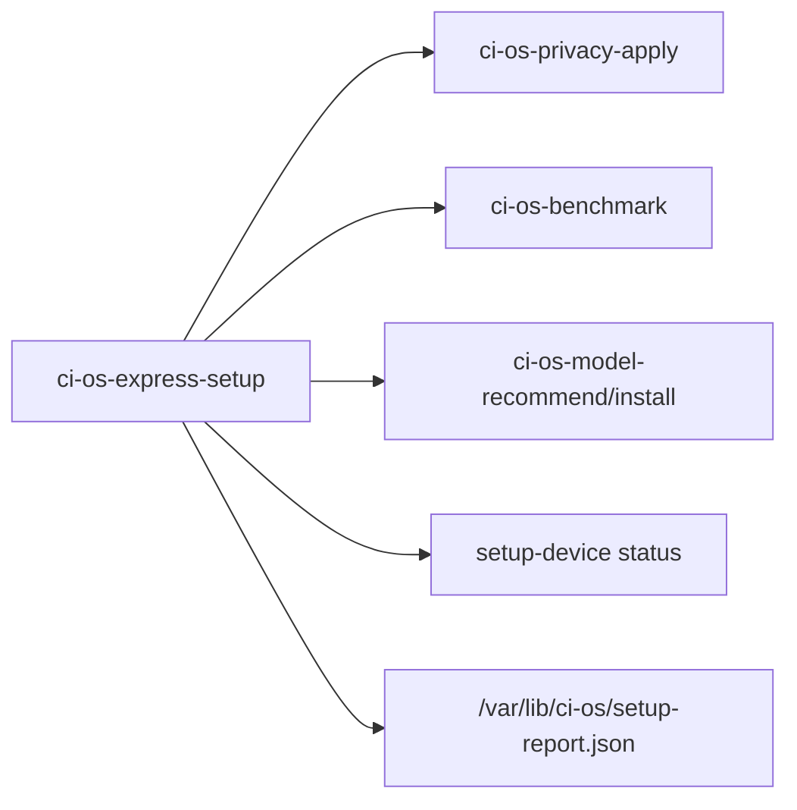

---

## Headless Setup Architecture

The headless package is a self-contained first-time network setup mode. If the device has no internet connectivity, it broadcasts a setup hotspot. Users connect to the hotspot, open a captive portal, select a WiFi network, and submit credentials. The backend creates a NetworkManager profile and optionally validates a Hub pairing code with the cloud.

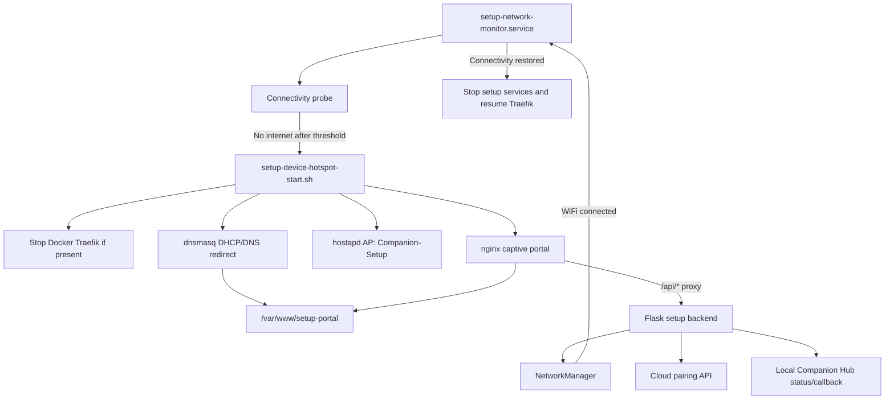

### Headless User Flow

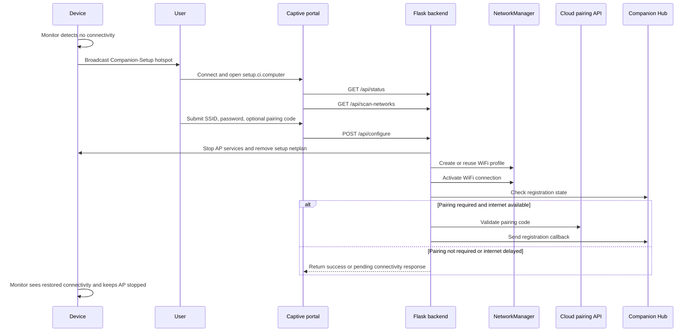

### Headless Services

| Service | Unit File | Role |
|---|---|---|
| Setup backend | `setup-backend.service` | Runs `/opt/setup-backend/setup_service.py` as root |
| Network monitor | `setup-network-monitor.service` | Starts setup mode when internet is unavailable |
| Hotspot AP | `hostapd-setup.service` | Runs hostapd with setup SSID |
| DHCP/DNS | `dnsmasq-setup.service` | Serves setup subnet and captive DNS redirects |
| Portal server | `nginx.service` | Serves UI and proxies API calls |

### Headless Network Defaults

| Setting | Default |
|---|---|
| WiFi interface | `wlp192s0` |
| SSID | `Companion-Setup` |
| WPA2 password | `SetupDevice123` |
| Gateway | `192.168.99.1` |
| DHCP range | `192.168.99.10` - `192.168.99.250` |
| Portal hostname | `setup.ci.computer` |
| Backend port | `5000` behind nginx `/api/` proxy |
| Hub status URL | `http://127.0.0.1:5002/api/registration/status` |
| Hub callback URL | `http://127.0.0.1:5002/api/registration/callback` |

### Headless Backend API

| Endpoint | Method | Behavior |
|---|---|---|
| `/health` | `GET` | Returns service health |
| `/api/status` | `GET` | Returns setup-complete flag status, pairing availability, and Hub registration state |
| `/api/scan-networks` | `GET` | Scans WiFi networks or uses cached scan results |
| `/api/configure` | `POST` | Accepts SSID/password/pairing code, creates a WiFi profile, connects, and optionally performs cloud registration |

---

## Package Architecture

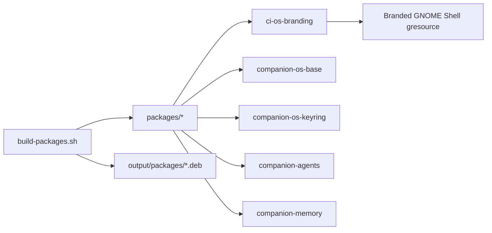

| Package | State | Purpose |
|---|---|---|
| `ci-os-branding` | Functional | Overrides Yaru GNOME Shell theme resource through `dpkg-divert` |
| `companion-os-base` | Functional shell package | Defines base CI-OS identity, branding, Plymouth/GRUB/MOTD utility intent |
| `companion-os-keyring` | Functional shell package | Installs keyring and source configuration for future CI package repo |
| `companion-agents` | Placeholder metapackage | Reserved for future AI companion services |
| `companion-memory` | Placeholder metapackage | Reserved for future memory/context services |
| `setup-device` | Separate package under `setup/headless` | Installs headless WiFi setup stack |

---

## CI/CD Architecture

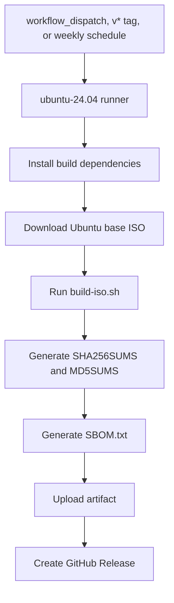

| Trigger | Version Source | Output |
|---|---|---|
| Manual dispatch | User input | Artifact and release |
| `v*` tag | Tag name without `v` | Artifact and release |
| Weekly schedule | `1.0-YYYYMMDD` | Artifact |

---

## Ubuntu 26.04 Upgrade Plan

Ubuntu 26.04 LTS is Resolute Raccoon, released on April 23, 2026. Ubuntu lists it as a supported LTS release with standard support until April 2031, and the Desktop release notes call out a 2 GHz dual-core CPU, 6 GB RAM, and 25 GB free storage as the comfortable-install baseline. CI-OS support should be implemented as a staged port with explicit compatibility checks.

Official references:

| Reference | Use |
|---|---|
| [Ubuntu 26.04 LTS release notes](https://documentation.ubuntu.com/release-notes/26.04/) | Release date, codename, support lifespan, requirements, and upgrade guidance |
| [Ubuntu releases index](https://releases.ubuntu.com/releases/) | Release directory names and ISO availability |

The current system has several Ubuntu 24.04 assumptions that are intentionally conservative: Ubuntu-compatible identity is preserved during install, the ISO volume ID is preserved for boot compatibility, specific `casper` squashfs layers are merged and replaced, and GDM branding is compiled from Yaru resources. Any of those can change across Ubuntu releases.

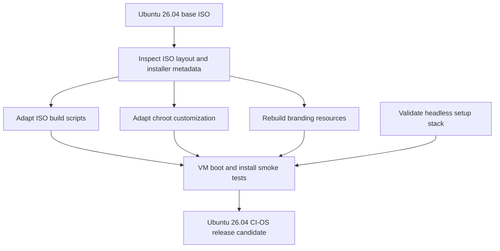

### Compatibility Questions

| Area | Ubuntu 24.04 Assumption | Ubuntu 26.04 Check |
|---|---|---|
| Base media | Desktop ISO URL and filename point to `ubuntu-24.04.1-desktop-amd64.iso` or local 24.04 defaults | Confirm Ubuntu 26.04 Desktop ISO URL, filename, checksums, and `resolute` directory/codename use |
| Casper layers | Main layers are `minimal.squashfs`, `minimal.standard.squashfs`, and `minimal.standard.live.squashfs` | Verify layer names, language overlays, enhanced-secureboot layers, and `.size` files |
| Installer metadata | `install-sources.yaml` IDs remain `ubuntu-desktop-minimal` and `ubuntu-desktop` | Confirm Subiquity expects the same IDs and schema |
| OS identity | `ID=ubuntu`, `VERSION_ID=24.04`, `UBUNTU_CODENAME=noble` are kept until first boot | Use installer-compatible Ubuntu values for 26.04, including `VERSION_ID=26.04` and `UBUNTU_CODENAME=resolute` if required |
| Requirements | Existing docs and scripts assume Ubuntu 24.04-era desktop requirements | Update docs and smoke-test VM sizing for the 26.04 Desktop baseline of 6 GB RAM and 25 GB free storage |
| Snap seed | Snap seed must not be modified during ISO customization | Reconfirm Ubuntu 26.04 snap seed validation behavior and installer snap names |
| GDM/Yaru | GNOME Shell theme resource path and Yaru asset structure are stable | Rebuild and validate gresource extraction/patching against Ubuntu 26.04 Yaru |
| Desktop provision | Whitelabel config lives under `/usr/share/desktop-provision` | Confirm Ubuntu 26.04 installer branding paths and supported keys |
| Boot behavior | Original volume ID must be preserved with xorriso boot replay | Confirm EFI/BIOS boot search behavior with Ubuntu 26.04 media |
| First boot | `ConditionFirstBoot=yes` and `/cdrom/casper/vmlinuz` live-session guard work | Validate first-boot services run only on installed systems |
| Packages | APT package names remain available on the new release | Audit removed/renamed packages and third-party repository support |

### Upgrade Workstreams

| Workstream | Tasks | Output |
|---|---|---|
| ISO discovery | Mount Ubuntu 26.04 ISO, inventory `casper/`, manifests, boot configs, volume ID, installer configs, and snap seed | `docs/ubuntu-26-discovery.md` or equivalent findings |
| Builder port | Update version defaults, layer handling, checksum verification, `install-sources.yaml`, and CI workflow inputs | Local Ubuntu 26.04 ISO build succeeds |
| Chroot port | Update codename/version values, package installs, first-boot scripts, ROCm helper notes, and cleanup assumptions | Live session boots and installed system rebrands correctly |
| Branding port | Regenerate GDM gresource from Ubuntu 26.04 Yaru, validate GNOME/GDM/Plymouth/KDE assets | Branding validation passes on live and installed systems |
| Headless port | Test NetworkManager, hostapd, dnsmasq, nginx proxying, Flask API, Hub pairing, and WiFi interface config | Headless setup provisions WiFi on Ubuntu 26.04 |
| CI assurance | Add shellcheck, package build checks, base ISO checksum verification, VM boot, and install smoke tests | Repeatable CI signal before release |

### Proposed File Changes

| File or Directory | Expected Change |
|---|---|
| `.github/workflows/build-companion-os-iso.yml` | Add Ubuntu 26.04 inputs, base ISO checksum verification, and release matrix when both 24.04 and 26.04 are supported |
| `tools/iso-build/scripts/build-iso.sh` | Make release/codename/layer names configurable and fail clearly when the ISO layout differs |
| `scripts/customize-chroot.sh` | Parameterize Ubuntu release metadata, first-boot identity values, package lists, and installer paths |
| `tools/iso-build/scripts/build-gdm-branding-gresource.sh` | Validate Ubuntu 26.04 Yaru resource paths before patching |
| `configs/packages/package-list.txt` | Split common packages from release-specific packages |
| `setup/os-changes/common/` | Re-test each desktop branding step and update validation checks |
| `setup/headless/setup-device/` | Move interface and setup network defaults into config; re-test package install on Ubuntu 26.04 |
| `docs/guides/` | Add Ubuntu 26.04 build, install, and troubleshooting notes |

### Acceptance Criteria

| Category | Required Evidence |
|---|---|
| Build | Ubuntu 26.04 ISO builds from a verified base ISO without manual intervention |
| Boot | ISO boots in UEFI and BIOS-compatible VM modes |
| Installer | Live session starts and installer completes without Subiquity/curtin identity failures |
| Installed OS | First-boot rebrand runs once and reports CI-OS identity afterward |
| Branding | Plymouth, GDM, GNOME session, wallpaper, start icon, MOTD, and optional KDE theme render correctly |
| Tooling | First-boot setup can install or gracefully skip third-party tooling on Ubuntu 26.04 |
| Headless | Setup hotspot appears, captive portal loads, WiFi credentials apply, and AP stops after connectivity |
| Release | Checksums are generated, signed when configured, and documented with a smoke-test record |

### Recommended Branching Strategy

Keep Ubuntu 24.04 support stable while porting:

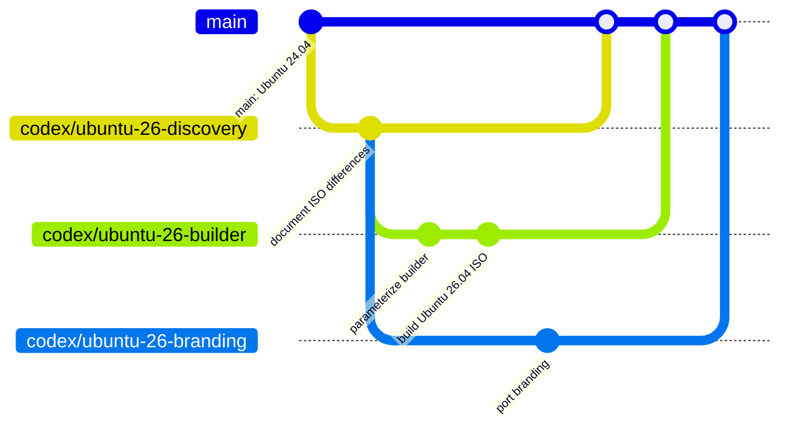

---

## Data and Configuration Flow

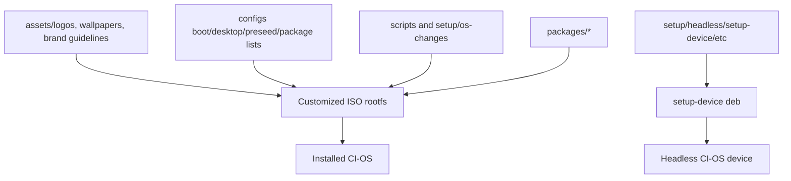

---

## Improvement Assessment

### Strengths

| Strength | Why It Matters |
|---|---|
| Installer compatibility is explicitly handled | The repo avoids breaking Subiquity by preserving Ubuntu IDs until first boot |
| Layered squashfs behavior is documented in code | This reduces risk when remastering Ubuntu 24.04 Desktop |
| ISO build and installed-system branding are separate | Operators can build images or apply branding to existing installs |
| Headless setup is packaged as a `.deb` | The first-time setup stack can be installed, removed, and iterated independently |
| Scripts are mostly idempotent | Re-running setup is often supported without starting from scratch |
| GitHub Actions workflow exists | ISO builds can be repeated from tags, schedule, or manual dispatch |

### Risks and Gaps

| Priority | Area | Finding | Recommendation |
|---|---|---|---|
| High | Headless hardware support | WiFi interface is hardcoded as `wlp192s0` across hostapd, dnsmasq, netplan, and scripts | Detect the WiFi interface at install/start time or configure it through `/etc/setup-device/device.conf` |
| High | Setup hotspot security | The hotspot uses a fixed password, `SetupDevice123` | Generate per-device credentials and store them root-only |
| High | Secrets hygiene | `scripts/lib/postgresql-setup.sh` contains a hardcoded PostgreSQL password | Replace with env/config input and rotate any deployed credential |
| High | Privilege boundaries | The Flask setup backend and many setup scripts run as root | Split privileged operations into narrow helpers or systemd-polkit actions |
| Medium | First-boot duplication | `setup-fresh-ubuntu.sh` and generated first-boot setup logic overlap | Share one library or generate both paths from the same install modules |
| Medium | Network checks | Connectivity logic relies on pinging public IPs/gateways | Add configurable probes and captive-network aware checks |
| Medium | Release integrity | Base ISO download is not checksum-verified in workflow | Verify Ubuntu ISO checksum before build and require signed release checksums |
| Medium | Package completeness | `companion-agents` and `companion-memory` are placeholder metapackages | Mark them as roadmap packages or add actual dependencies |
| Medium | Test coverage | Validation is mostly manual and shell-driven | Add shellcheck, Python unit tests, package install tests, and a VM boot smoke test |
| Low | Documentation overlap | Several docs duplicate setup and ISO build guidance | Keep this file canonical for architecture and link out to task-specific guides |

### Suggested Technical Backlog

| Milestone | Work |
|---|---|
| 1. Hardening | Dynamic WiFi interface detection, generated AP credentials, remove hardcoded DB password |
| 2. Build assurance | Base ISO checksum verification, shellcheck, package build CI, Python backend tests |
| 3. Runtime safety | Least-privilege setup backend, narrower sudo/systemd operations, structured logging |
| 4. Productization | Real package dependencies for companion agents and memory, versioned config schema |
| 5. Release quality | Signed checksums by default, VM smoke boot, installation smoke test, rollback docs |

---

## Operational Commands

| Task | Command |
|---|---|
| Build ISO | `sudo ./tools/iso-build/scripts/build-iso.sh --base-iso <ubuntu.iso> --version <version> --clean` |
| Build CI-OS packages | `./tools/iso-build/scripts/build-packages.sh ./output/packages` |
| Apply desktop branding | `sudo ./setup/os-changes/apply-ci-os-desktop.sh` |
| Validate desktop branding | `./setup/os-changes/apply-ci-os-desktop.sh --validate` |
| Setup fresh Ubuntu | `sudo ./scripts/setup-fresh-ubuntu.sh` |
| Build headless setup package | `cd setup/headless && ./build.sh` |
| Install headless setup package | `sudo dpkg -i setup-device_*.deb` |
| Check headless services | `systemctl status setup-backend setup-network-monitor hostapd-setup dnsmasq-setup nginx` |
| View setup backend logs | `journalctl -u setup-backend.service -n 100 --no-pager` |
| View network monitor logs | `journalctl -u setup-network-monitor.service -n 100 --no-pager` |

---

## File Ownership Summary

| Path | Responsibility |
|---|---|
| `tools/iso-build/scripts/` | ISO orchestration and package build helpers |
| `scripts/customize-chroot.sh` | Image rootfs customization |
| `scripts/setup-fresh-ubuntu.sh` | Existing Ubuntu machine setup |
| `scripts/lib/` | Shared setup helper libraries, some legacy |
| `setup/os-changes/` | Desktop and OS branding for installed systems |
| `setup/headless/` | Headless WiFi setup package and runtime stack |
| `packages/` | Debian package source trees |
| `configs/` | Boot, desktop, package, preseed, and customization inputs |
| `assets/` | Logos, wallpaper, and brand guidance |
| `.github/workflows/` | CI/CD ISO builds and releases |

---

## Bottom Line

CI-OS is an Ubuntu remastering and provisioning repo with three main operational surfaces:

1. Build a branded Ubuntu-based CI-OS ISO.
2. Apply CI-OS branding and tooling to installed systems.
3. Provision headless devices onto WiFi through a local setup portal.

The architecture is workable and thoughtfully commented in the ISO-critical areas. The next biggest gains are hardening device-specific assumptions, removing fixed credentials, consolidating duplicated setup logic, and adding automated tests around package install, backend behavior, and VM bootability.
