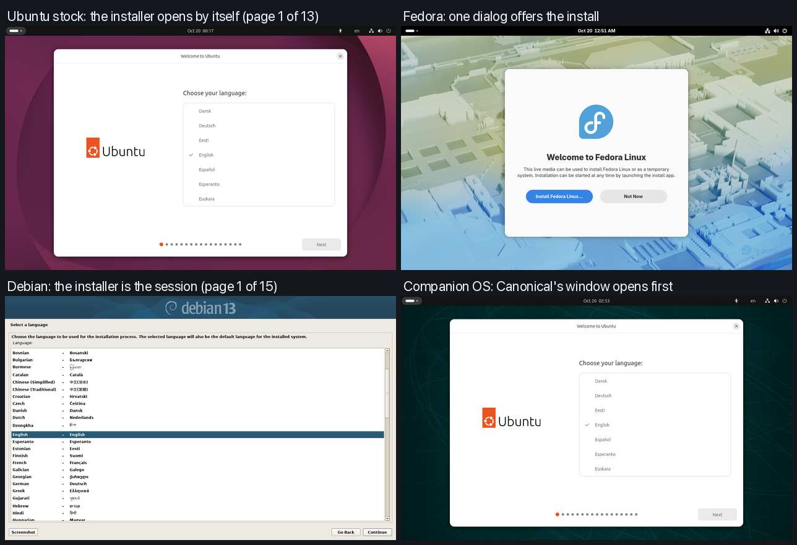
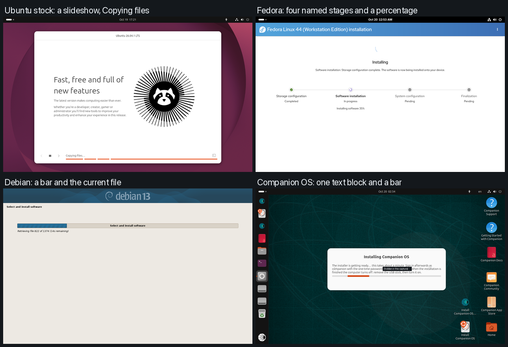
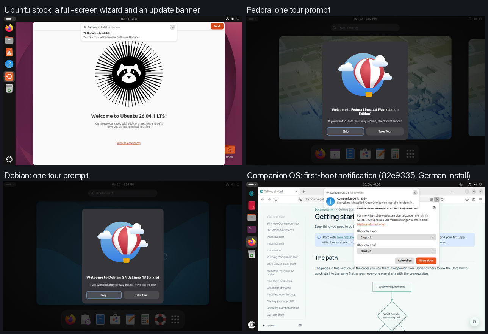

# First-run teardown: how other distros install and start, next to Companion OS

> **Private & Confidential. Property of Lifescope Inc. Do not distribute.**
> State of 2026-10-19 (local time). **Evidence label for every number and picture on this page: tested in a virtual machine** (QEMU 11.1.2 with the host's own accelerator, HVF, on one Apple-silicon Mac, arm64 guests, **one run of each distro, no real hardware**). Tags: **[V]** verified (run, result seen), **[I]** read from code or documentation, not run, **[N]** not checked.

## Summary

One run each of stock Ubuntu 26.04.1, Fedora Workstation 44 and Debian 13.7 (its graphical installer: Debian publishes no arm64 live image), read with the
stopwatch and counts the polish proposal asks for and set next to the Companion OS records of the same day. What the runs show:

* **Companion OS already asks the least**: one confirmation, against 4 pages (Fedora), 13 (Ubuntu) and 15 plus 5 more (Debian). It is also the only one that removes
  Ubuntu's telemetry in the image and says on screen what the machine is doing after the install. **[V]**
* **It is the only one that shows two installers at once.** Canonical's 13-page window, with Ubuntu's name and logo, opens in front of Companion's dialog in both boot
  entries. Fedora's live session opens with one dialog and two buttons and no installer until the user asks. **[V]** (Figure 1 in
  [Frames](#frames))
* **The best installer in the set is Fedora's**: 4 pages, nothing typed, four named stages with a percentage, 3 min 52 s, then a first-run wizard that creates the
  account. Companion's install takes 2.4 to 3.1 times as long, shows one block of text and a bar with no percentage, and hands out a one-time password that the user
  must copy and replace at the first sign-in. **[V]**
* **All three stock installs read `running` with no failed unit; Companion reads `degraded`** (`pd-mapper.service`, KI-28). **[V]**
* **Companion is slower to the same places**: the live desktop at about 1:53 against 1:01 (Fedora) and 1:08 (stock Ubuntu), the greeter at 50 s against 30 to 34 s.
  The Companion figures come from other evenings and loads, so the size of the gap is **[I]**; that it exists is likely, because three Companion runs of the day
  (`4b7597d`, `b124745`, `82e9335`) each put the live desktop about 2 minutes after power-on. The cause was not looked for **[N]**.
* **The idle lock is not a Companion gap**: every distro blanks the screen after 5 minutes and locks the session. **[V]**
* What to do about it is the [ranked list](#gaps-ranked-by-what-the-best-installers-do), mapped to the proposal's items: 5, 6 and 7 move up, 8 stays, and five items
  are new. [The scorecard](#scorecard-against-companion-os) counts where Companion stands: ahead on 3 measures, level on 4, behind on 10 (one row is not scored).

## Scope and what was not measured

The question behind this page: the owner asked how to make the install and the first start of Companion OS look as good as the major Linux distros. The
polish backlog in CI-Engineering (`proposals/companion-os-home-lab-polish.md`) is ranked by effort; this page adds what the distros that most people
install actually do, measured the way that proposal asks for ("stopwatch from the first boot-menu frame, and a count of windows, tabs, notices and failed
units the user did not ask for").

| Distro | Run | Why this one |
|---|---|---|
| Ubuntu 26.04.1 LTS desktop, **stock** | [V] | the base of Companion OS, and the control: what the Ubuntu edition changed is the difference to this column |
| Fedora Workstation 44 Live | [V] | the other big desktop installer (Anaconda, new web interface) and a first-run wizard of its own |
| Debian 13.7.0, graphical installer (netinst) | [V] | the classic installer. **Debian publishes no arm64 live image** (its live images are amd64 only, checked 2026-10-19 in `debian-cd/current-live/`), so this is the installer a Debian user gets on arm64, and its install downloads packages from a mirror |
| openSUSE Tumbleweed GNOME live (aarch64) | [N] | the images exist (GNOME, KDE and XFCE live, about 1.3 to 1.4 GiB) but the owner did not approve their download |
| Linux Mint, Pop!_OS, elementary OS, Zorin | [N] | no arm64 desktop ISO was checked for; amd64 guests under emulation are too slow to give comparable times |

Not measured: any real hardware, amd64, Secure Boot, a second run of any distro (so no spread), Wi-Fi or a captive-portal network, a slow link, a language other
than English, an upgrade or a dual boot. The Companion OS column is **not** a new run (see above).

## How the runs were made

Every distro went through the same steps on the same virtual machine, driven by the repository's own arm64 harness
([`boot-arm64-vm.sh`](../../backends/ubuntu/iso/tests/boot-arm64-vm.sh), [`lib/qmp-drive.py`](../../backends/ubuntu/iso/tests/lib/qmp-drive.py),
[`record-frames.sh`](../../backends/ubuntu/iso/tests/record-frames.sh); how they work is in [Testing in QEMU](../guides/testing-in-qemu.md)).
The recorder was started before power-on and took a screendump about every 3 seconds until the run ended, so every time on this page is read from a frame
(a resolution of about 3 seconds) or from a command's own timestamp.

| Item | Value |
|---|---|
| Machine | Apple-silicon Mac, 12 cores, 96 GiB RAM, macOS 27; QEMU 11.1.2, `-machine virt,gic-version=3 -accel hvf -cpu host -smp 6 -m 8192`, edk2 aarch64 firmware without Secure Boot |
| Display, input | `virtio-gpu-pci` at 1280 by 800, `qemu-xhci` with `usb-kbd` and `usb-tablet`, driven over QMP |
| Media | the ISO as a USB mass-storage drive on `bootindex=0` (what a flashed stick looks like to the firmware); a blank 64 GiB virtual NVMe disk as the install target, a file on a RAM disk so that the host's snapshots never pin it |
| Network | QEMU user networking (NAT), the host's real internet connection |
| Host load | other sessions used the same Mac during the runs (a one-minute load average of 7 to 62 at the starts, from searches and another virtual machine that were not ours); every run records its load in `run.txt`. Treat a time as a figure for this machine on this evening, not as a benchmark |
| Account | a throwaway name and a random password typed from a file; no password, key or token is in any frame or text record |

**What counted, the same for every distro.**

| Measure | How it was read |
|---|---|
| Stopwatch | t0 is the first frame that shows the distro's own boot menu (the firmware's frames before it are not counted). Times after it are "t0 plus" |
| Time to a live desktop | t0 to the first frame that shows the session's desktop (panel and wallpaper) |
| Installer opens by itself | an installer window or dialog is in front without a click, or the boot menu's default entry starts an install |
| Questions before the install starts | **pages** the user must pass before the install begins (counting the last review page, not the live session's own welcome), **typed values** (fields typed into), and **choices left at their default** on those pages |
| Languages, keyboard, time zone | what the installer offered, asked or detected, read from its pages |
| Install time | the click that starts the install to the first frame of the installer's own "done" page |
| First sign-in | from the first drawn desktop of the installed system until nothing more appeared for a minute: **windows**, **browser tabs**, **notices** (banners and pop-ups) the user did not ask for, and the first-run pages |
| Failed units | `systemctl --failed` (system and user) read by a read-only script about 5 minutes after the first sign-in, over a text channel (the guest fetches the script from a loopback server on the host and posts the text back; [`guest-facts.sh`](../evidence/2026-10-19-ftue-teardown/guest-facts.sh)) |
| Progress for post-install work | whether anything on screen says that the machine is still working after the install |
| Idle behaviour | the first frame that is black after the last input, and whether the session is locked |

An installer's own wizard is counted as a "page" when it stops and waits for the user, whether it asks a question or only informs. Typing speed was
limited by the test driver (a password field that checks strength dropped keys at 0.14 seconds per key and had to be retyped slowly; a person would
not meet that, so it is not counted as a defect).

**Images.** Each file was checked against its vendor's signed checksum list before it was booted
([`verify-downloads.txt`](../evidence/2026-10-19-ftue-teardown/verify-downloads.txt)): stock Ubuntu 26.04.1 desktop arm64 (the file cached by the repository's
tests, equal to Canonical's signed `SHA256SUMS`), Fedora Workstation Live 44-1.7 aarch64 (signed `CHECKSUM`, key
`36F612DC...90A6`), Debian 13.7.0 arm64 netinst (signed `SHA256SUMS`, key `DF9B9C49...BE9B`). The owner approved the two downloads before they were
made. **Companion OS** is not re-run on this page: its column comes from the records of the same harness, on the same machine class, of 2026-10-19
(`docs/evidence/2026-10-19-ubuntu-arm64-*`; the image of `82e9335` for the install, boot and first-boot figures, the image of `ee4a3b4` for the first
sign-in counts), so its numbers were taken on other evenings at other loads.

## Results

### The install, from the boot menu to the end of the installer

| Measure | Ubuntu 26.04.1 stock | Fedora 44 Workstation | Debian 13.7 netinst | Companion OS (Ubuntu edition) |
|---|---|---|---|---|
| Boot menu, default entry | "Try or Install Ubuntu", a 30 s countdown | "Test this media & start", a countdown of about 10 s (it ran by itself) | text-mode "Install" highlighted, **no countdown**; "Graphical install" is the second line | "Try or Install Companion OS", a 30 s countdown; "Install Companion OS (automatic)" is the second line, and the runs chose it with Down, Enter [V] (frame `arm64-01`) |
| t0 to a live desktop | **1:08** (a text boot log for 55 s first, no splash) | **1:01** (a black screen with no text for about 50 s first) | no live session: the installer is the session, first page at t0 + 0:23 (of which 18 s were at the menu) | about **1:53** (`82e9335`: Enter at 23:12:49, desktop at 23:14:30; t0 taken as power-on plus 12 s, the menu time of the `4b7597d` record) [V] |
| Installer opens by itself | yes, a 13-page window in front, one page asks "Try or Install" | **no**: a Welcome dialog offers "Install Fedora Linux..." or "Not Now" | yes (it is the whole session) | yes: Canonical's 13-page window opens in front in both entries; the automatic entry opens the one-click dialog **behind** it, and two "Install Companion OS" launchers are on the desktop and in the dock [V] |
| Pages before the install starts | **13** (the last is the review) | **4** (language and keyboard; method; encryption; review) | **15** before the disk is written, then **5 more** questions while it installs (mirror country, mirror, proxy, survey, software) | **1** confirmation (the disk, what is on it, a one-time password), plus an optional "Language, keyboard, time zone" dialog; the user must first pick the second boot entry or click the launcher, and close Canonical's window [V] |
| Typed values | 3 (a name, the password twice; user and computer names are filled in) | **0** (the account comes later) | 3 (a name, the password twice; root left empty, user name derived) | **0** in the installer |
| Languages in the first list | not counted [N] | not counted [N] (four "suggested" ones on top, then a search) | **78** rows (77 languages and "C") [V] | **59** locales of 8 languages, behind a button [V] (`one-click-install.md`) |
| Keyboard | asked, English (US) preselected, a Detect button and a test field | shown on the first page ("us", a change link) | asked, American English preselected | follows the language, changeable in the optional dialog |
| Time zone | asked on a map, **pre-filled by geolocation** | **not in the installer**; set from the location in the first-run wizard | asked from a list of the country's zones, default Eastern, **no detection** | optional dialog, "detected automatically" is the default; the live clock followed the zone chosen in `b124745` [V], the automatic choice itself was not run [I] |
| Install time | **10 min 02 s** | **3 min 52 s** | **6 min 24 s** from the disk write, 1 min 20 s of it spent answering the five questions (the packages came from a mirror) | **9 min 22 s** to **12 min 10 s** over three images of the same harness |
| What the installer's progress shows | a slideshow and a segmented bar with "Copying files..." | **four named stages, each marked, a percentage and the current step** ("Installing boot loader", "Generating initramfs") | a bar and the current package ("Unpacking apt-utils...") | one text block ("this takes a while") and a bar with no percentage |
| End | "Restart now" or "Continue testing"; the stick is not mentioned | "Successfully installed", one button "Exit to live desktop", a feedback QR code | "Installation complete", **says to remove the installation media**, then "Continue" | the machine powers itself off; the text says to remove the stick and turn it on |

### The first start of the installed system

| Measure | Ubuntu 26.04.1 stock | Fedora 44 Workstation | Debian 13.7 netinst | Companion OS (Ubuntu edition) |
|---|---|---|---|---|
| Power-on to the first screen | **30 s** to the greeter (a boot log, then the greeter) | **31 s** to the setup wizard (there is no greeter) | **34 s** to the greeter (about 8 s of it the boot menu) | **50 s** to the greeter (`82e9335`: 23:27:46 to 23:28:36) [V] |
| Sign-in to a drawn session | 5 s (the wizard window 2 s later, the updater banner 9 s later) | 4 s ("Start Using" to the desktop; the tour prompt a few seconds later) | 3 s (the tour prompt at 5 s) | about 21 s after the new password was confirmed (`82e9335`, 23:29:35 to 23:29:56) [V] |
| First-run wizard | **6 pages**: welcome, Ubuntu Pro, location services, help improve Ubuntu, appearance, ready to go | **7 screens**: welcome, privacy, time zone, third-party repositories, about you, password, all done | **none** (the account was made in the installer) | **none**; instead a forced new password (one-time password, then a new one twice) [V] |
| Windows, tabs and notices the user did not ask for, first sign-in | the wizard window and **1 notice** ("72 Updates Available") | **1 modal prompt** (a tour), no notice | **1 modal prompt** (a tour), no notice | **1 window** (Firefox with **1 tab**, the Companion page, by design) and **0 notices** over 70 s of frames (`ee4a3b4`) [V] |
| Work that continues after the first screen | none | none | none | the first-boot job (2 min 11 s to 2 min 28 s), **shown by notifications**: "waiting", steps n of 7, "ready" [V] |
| Failed units, 5 to 8 minutes after boot | **0** (`running`) | **0** (`running`) | **0** (`running`) | **1** (`pd-mapper.service`, KI-28; the system reads `degraded`) [V] |
| Firewall, and ports open to the network | `ufw` service active, nothing listens beyond localhost | `firewalld` active; ports 5355 (LLMNR) and 27500 listen on all interfaces; what 27500 is was not looked up [N] | **none**; SSH (22) on all interfaces, because the "SSH server" box is ticked by default | `ufw` enabled as a service but inactive; SSH, Hub (5002), Traefik and **Ollama (11434)** on all interfaces [V] (CI-Engineering proposal, tier 2) |
| Telemetry defaults | the wizard asks about system data and error reports, **both off** | the wizard has location services and automatic problem reporting, **both on**; `abrtd` runs | a survey asked in the installer, **default No** | `ubuntu-report`, `popularity-contest`, `apport` and `whoopsie` removed and held (`backends/ubuntu/lib/remove-telemetry.sh`) [I]; the first-run pages are skipped |
| Idle | the screen went black **5 min 02 s** after the last input and the session **locked** | **5 min 03 s**, **locked** | **5 min 02 s**, **locked** | the same, seen in `82e9335` (a GNOME default) [V] |
| Installed system | 1505 packages, 11 GB used, 3 error-level journal lines, boot 22.5 s | 1958 packages, 4.1 GB, **188** error-level lines, boot 17.6 s | 1565 packages, 5.0 GB, 1 error-level line, boot 21.1 s | 19 GB used of 62 GB (Hub's images and two models included), `graphical.target` after 18.5 s of userspace on `4b7597d` [V]; packages and journal lines were not read [N] |

### What the screens look like

| | Style | Words | Companion OS next to it |
|---|---|---|---|
| Ubuntu | a Flutter window in the Yaru light theme, one illustration per page with an orange accent, page dots at the bottom; the first-run wizard is a full-screen GNOME window with the same illustrations | short, friendly ("Fast, free and full of new features") | the same window opens first, then Companion's dialog; the Companion wallpaper is dark teal, the Canonical window is light |
| Fedora | a web page in a window: a blue gradient header, a **numbered list of steps on the left**, large type, flat buttons; the first-run wizard is plain GNOME with large icons | plain, one idea per screen | none of this: Companion's dialog is a small stock GTK dialog with a table |
| Debian | the 2000s GTK installer: a beige page under a **"debian13" banner**, long explanatory paragraphs (the root password page is five paragraphs), a Go Back button on every page | accurate and long (the root password page is five paragraphs) | the opposite pole: Companion's text is short |
| Companion OS | the desktop itself is dark teal with Companion icons; the installer dialog and the progress window are small, light, unbranded GTK dialogs; notifications are GNOME's | terse | see [Frames](#frames) |

## Frames

Every frame is a screen capture (QMP `screendump`, 1280 by 800) of a QEMU virtual machine on an Apple-silicon Mac with hardware acceleration (HVF). **None comes
from real hardware.** The three figures below are composites of four frames each, reduced to 632 pixels wide and captioned; they are not captures
(`docs/ui/ftue-teardown/MANIFEST.json` lists what each is made from). The Companion OS panels are frames of the existing set in
[`docs/ui/companion-os/ubuntu/`](../ui/companion-os/ubuntu/CAPTURE.md).



*Figure 1. The first screen after the boot menu (virtual machine). Ubuntu and Companion OS open Canonical's 13-page installer by themselves; Fedora opens one dialog with
two buttons; Debian's installer is the session.*



*Figure 2. The install in progress (virtual machine). Only Fedora names its stages and shows a percentage.*



*Figure 3. The first sign-in (virtual machine). The Companion OS panel is the German install of image `82e9335`: the notification is the wanted progress message, and the
translation offer over the page is Firefox's own (the English runs of `ee4a3b4` showed no pop-up).*

| Set | Frames | Manifest |
|---|---|---|
| Ubuntu 26.04.1 stock | 14: boot menu, live boot, 4 installer pages, progress, done, greeter, 4 first-run pages, the desktop after | [`ubuntu-stock/MANIFEST.json`](../ui/ftue-teardown/ubuntu-stock/MANIFEST.json) |
| Fedora Workstation 44 | 10: boot menu, live welcome, 2 installer pages, progress, done, 3 first-run pages, first session | [`fedora/MANIFEST.json`](../ui/ftue-teardown/fedora/MANIFEST.json) |
| Debian 13.7 netinst | 11: boot menu, 5 installer pages, the software selection, progress, done, greeter, first session | [`debian/MANIFEST.json`](../ui/ftue-teardown/debian/MANIFEST.json) |

Hygiene (the rules of [`docs/ui/companion-os/README.md`](../ui/companion-os/README.md)): the raw bytes of every PNG and every text record were searched for the throwaway
password and its halves (0 hits), every frame was read by OCR and searched for host names, user names, e-mail and IP addresses, hex strings of 24 or more digits and the
host's region (0 hits), and each frame was looked at. The time zone pages that pre-select the host's region (Ubuntu's map, Fedora's map) are **not** published; the installer
pages show the throwaway account name and the date of the run.

## Scorecard against Companion OS

Verdicts compare Companion OS with the best of the three stock installs on the same measure. "Ahead", "level" and "behind" are the author's reading of the table; a
number is quoted wherever there is one.

| # | Measure | Best of the three | Companion OS | Verdict |
|---|---|---|---|---|
| 1 | Pages before the install starts | Fedora, 4 | 1 confirmation (plus the boot-entry pick and closing Canonical's window) | **Ahead** |
| 2 | Typed values in the installer | Fedora, 0 | 0 | Level |
| 3 | Installers on screen at once | 1 (Fedora: none until asked) | 2 (Canonical's window and the dialog) | **Behind** |
| 4 | t0 to a live desktop | Fedora, 1:01 | about 1:53 (other evening) | **Behind** |
| 5 | Install time | Fedora, 3:52 | 9:22 to 12:10 | **Behind** |
| 6 | Install progress detail | Fedora: four named stages, a percentage | one text block, a bar with no percentage | **Behind** |
| 7 | Power-on to the first screen | Ubuntu, 30 s | 50 s (other evening) | **Behind** |
| 8 | Account and password | the user picks both during setup (Ubuntu, Fedora, Debian) | a one-time password to copy, then three password entries at the first sign-in | **Behind** |
| 9 | First-run pages to pass | Debian, 0 | 0 | Level |
| 10 | Windows and notices not asked for at first sign-in | Fedora, Debian: 1 modal prompt | 1 window (Firefox, 1 tab), 0 notices | Level |
| 11 | Failed units | 0 (all three) | 1 | **Behind** |
| 12 | Telemetry | Ubuntu and Debian ask, default off; Fedora default on | packages removed in the image [I] | **Ahead** |
| 13 | Services reachable from the LAN | Ubuntu: none | SSH, Hub, Traefik, Ollama | **Behind** |
| 14 | Says what the machine is doing after the install | nobody does | notifications, "step n of 7" | **Ahead** |
| 15 | Idle blank and lock | all: 5 minutes, then locked | the same | Level |
| 16 | Languages in the first list | Debian, 77 (Ubuntu and Fedora not counted) | 59 locales of 8 languages, behind a button | **Behind** |
| 17 | Look of the installer and first-run pages | Fedora and Ubuntu: branded, illustrated pages | small unbranded GTK dialogs; Canonical's window first | **Behind** |
| 18 | The end of the install | a "done" page with the next step (all three) | the machine powers off; the progress text says to remove the stick | not scored (by design for a stick) |

**Ahead on 3, level on 4, behind on 10, one not scored.** Row 12 is **[I]** (read from the build script); every other verdict rests on a frame or a record. Rows 4 and 7 compare
runs of different evenings.

## Gaps, ranked by what the best installers do

The order is: seen by every user at every install, then how many of the three stock installs do better, then the cost. The "Item" column is the number in
`proposals/companion-os-home-lab-polish.md` (CI-Engineering); **N1 to N5** are new.

| Rank | Gap | What the best do | Companion OS today | Item | Effort |
|---|---|---|---|---|---|
| 1 | **Two installers at once.** Canonical's window, with Ubuntu's name and logo, opens in front of Companion's dialog | one installer, or none until the user asks (Fedora: a dialog with "Install" and "Not Now") **[V]** | Canonical's 13-page window in both boot entries, the dialog behind it, two launchers **[V]**. The owner's request of 2026-10-19 ("hide the parts of the Ubuntu wizard") is this gap | 5 | M |
| 2 | **A password to copy, then three to type.** The one-time password has to be written down, typed at the greeter, then replaced twice | the user picks the name and the password during setup and has nothing to remember (all three) **[V]** | one-time password in a dialog ("write it down now"), typed at the greeter, then the forced change **[V]** | 6 | M |
| 3 | **A failed unit at every start** on an arm64 machine that is not a Snapdragon | none: `running` on all three **[V]** | `pd-mapper.service` fails, the system reads `degraded`, `ci-os-info` says "1 failed service(s)" **[V]** | 7 | S |
| 4 | **Services open to the LAN.** Not seen in the first ten minutes, but the one gap here that is a risk and not a look | Ubuntu: nothing beyond localhost; Fedora: a firewall and two ports; Debian: SSH only **[V]** | SSH, Hub, Traefik and an unauthenticated Ollama on all interfaces, `ufw` inactive **[V]** (the proposal's run) | 8 | M, needs a human reviewer |
| 5 | **No sense of progress for 9 to 12 minutes** | Fedora: four named stages with marks, a percentage, the current step; Debian: the current package **[V]** | one text block and a bar with no percentage **[V]** | N1 | S to M |
| 6 | **Slow to the same screens** (live desktop +52 s against Fedora, +45 s against its own base; greeter +20 s) | 1:01 and 30 s **[V]** | about 1:53 and 50 s on other evenings, three Companion runs agree on "about 2 minutes" **[I]** | N2 | S to find, unknown to fix |
| 7 | **Plain, unbranded dialogs.** The Companion look is on the wallpaper only | branded, illustrated pages with one idea each (Fedora, Ubuntu) **[V]** | a small stock GTK dialog with a table, a progress dialog, GNOME's notifications **[V]**. The owner's request for a dark, green theme lands here | N3 | M |
| 8 | **The install takes 2.4 to 3.1 times Fedora's** | 3:52 for 4.1 GB used **[V]** | 9:22 to 12:10; 11 GB used on stock Ubuntu, 19 GB after Companion's first boot **[V]**. Profile before acting; a one-off cost | N4 | M to L |
| 9 | **No "installed" page.** The machine just powers off | a page that says what happened and what to do next (Debian: remove the media; Fedora: exit, and a feedback code) **[V]** | the progress text says to remove the stick and turn the computer on **[V]** | N5 | S |

**What the best installers also do that Companion OS should not copy.** Debian's 20 questions and paragraphs of text; Ubuntu's 13 pages, its Ubuntu Pro page and its
update banner at the first sign-in; Fedora's default-on location services and problem reporting; Debian's software list that ticks no desktop, so that pressing Continue
installs a system without one; the SSH server ticked by default.

**What Companion OS does better and must keep** (the proposal says the same): one page for the install, no telemetry or upsell pages, no first-run wizard, and a
notification that says what the machine is doing until it is ready.

## Limits and how to repeat a run

**Limits.**

* One run of each distro, so there is no spread. The host was busy with other sessions (a one-minute load average of 24 at the Fedora start, 23 at Debian, 7 at Ubuntu);
  the Companion figures come from other evenings. A difference of a few seconds means nothing; a difference of a factor of two is probably real.
* The live boot of the stock Ubuntu image **froze once** on a text boot log in the first attempt (the guest idle, no reaction to key or pointer for 4 minutes); the
  second attempt is the run. The Companion OS records of the same day show the same freeze once (`ee4a3b4`), so it is not specific to Companion OS **[I]**; the cause was not looked for.
* Debian's install fetched 1374 packages from a mirror over the host's connection, so its install time depends on the network.
* The question count is this page's definition (pages that wait for the user), not the distros'. Languages were counted by OCR of scrolled frames for Debian only.
* Every guest detected the host's real time zone by itself where it asks (Ubuntu, Fedora); a person elsewhere would see a different map.
* `systemctl --failed` was read once, 5 to 8 minutes after the first sign-in; a unit that fails later is not counted.
* openSUSE was not run (the owner did not approve the download); Linux Mint, Pop!_OS, elementary OS and Zorin were not looked for.
* Companion OS is not re-run here, and the streamlining the owner asked for on 2026-10-19 (no Ubuntu Pro prompting, no Canonical telemetry, the Ubuntu wizard hidden, a dark green
  theme) is a separate change; this page measures the state before it.

**Records.** Text records, the signature checks and the facts script are in [`docs/evidence/2026-10-19-ftue-teardown/`](../evidence/2026-10-19-ftue-teardown/) (`run.txt`
with the times, `events.txt` with every action, `installed-facts.txt`, `SHA256SUMS` per run, `verify-downloads.txt` for the signed lists). The frames are in
[`docs/ui/ftue-teardown/`](../ui/ftue-teardown/). One clip per distro was cut with `lib/make-video.py` and is kept outside the repository, like the raw frames, which show the
account typed in the installers.

**Repeat a run.** Needs Homebrew QEMU, Python 3 with Pillow and `ffmpeg`. The target disk goes on a RAM disk because a file deleted after an hourly Time Machine snapshot keeps its
space until the snapshot expires:

```bash
# 1. the image, checked against the vendor's signed list (verify-downloads.txt shows the commands for Ubuntu, Fedora and Debian)
# 2. a RAM disk for the target (16 GiB), and a disk file on it
DEV=$(hdiutil attach -nomount ram://33554432 | awk '{print $1}') && diskutil erasevolume HFS+ FTUE "$DEV"
/opt/homebrew/bin/qemu-img create -q -f qcow2 /Volumes/FTUE/target.qcow2 64G
# 3. record from before power-on, then start the VM and drive it (CI_VM_DIR must be a short path)
export CI_VM_DIR=$HOME/.cache/ftue-vm/run1 && mkdir -p "$CI_VM_DIR"
T=backends/ubuntu/iso/tests
bash $T/record-frames.sh "$HOME/ftue-frames/run1" 1.5 &
bash $T/boot-arm64-vm.sh start /path/to/the.iso /Volumes/FTUE/target.qcow2
python3 -I $T/lib/qmp-drive.py "$CI_VM_DIR/qmp.sock" click 640 400 1280x800
# 4. after the install: start the disk alone, the way a stick would be removed
bash $T/boot-arm64-vm.sh stop && bash $T/boot-arm64-vm.sh start - /Volumes/FTUE/target.qcow2
# 5. read the facts without OCR: a loopback server on the host, the script from the evidence directory in the guest terminal
#    (curl -s 10.0.2.2:8800/f.sh || wget -qO- 10.0.2.2:8800/f.sh) | sh -s NAME
# 6. one clip, then detach the RAM disk
python3 -I $T/lib/make-video.py out.mp4 --frames "$HOME/ftue-frames/run1" --chapters chapters.txt --clock
hdiutil detach /Volumes/FTUE
```

The stopwatch is read from the frame file names (`f-<epoch>.png`), which are the time the screendump was asked for: the first frame that shows the boot menu is t0, and a state
"appears" at the first frame that shows it.
