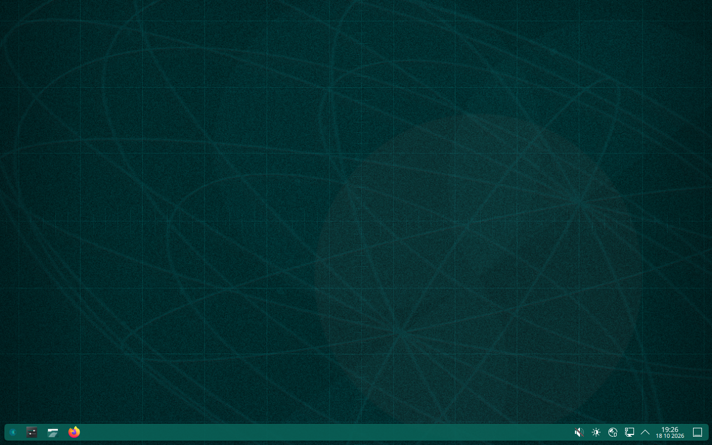

# Test evidence: what has been run, where, and what it showed

> **Private & Confidential. Property of Lifescope Inc. Do not distribute.**

State of 2026-10-18, afternoon Pacific time (the evidence records were copied into `docs/evidence/` after the first version of this page; the Plasma ISO #6 run, finished at 14:01, was added last). Supported targets: Companion OS on Ubuntu 26.04.1 LTS (resolute) and Companion OS on CachyOS (the "Plasma" edition). Retired 2026-10-17: Ubuntu 24.04, Linux Mint, Fedora, Bazzite, NixOS (restore from the tag `pre-retire-multidistro-2026-10-17`).

This page records, per edition and per stage, what has been **run** and what came out. It is written so that a claim can be traced: to a test name in the repository, to a command in a guide, or to a session record. Where a row says "pending", the row also says what will confirm it. What is wrong or undecided is in [known-issues-and-decisions.md](known-issues-and-decisions.md); how to repeat a run is in [Testing in QEMU](../guides/testing-in-qemu.md) and [Building on a Mac](../guides/building-on-a-mac.md).

## How to read this page

| Tag | Meaning |
|---|---|
| **[V]** Verified | the command was run, or the file read, and the result seen; the source is named |
| **[I]** Implemented, not proven end to end | the code and its unit tests exist; no run shows the behaviour on the real target |
| **[N]** Not implemented, or not checked | nothing exists, or nobody looked |

**Where the records are.** Test names, counts and commands are in the repository. The text records of the October 2026 runs that matter most (build records, `verify-iso.sh` logs, installed-boot results, the sha256 of each image) are in [`../evidence/`](../evidence/README.md) and cited as `docs/evidence/<directory>/<file>`. The records and the 29 frames of the **Plasma ISO #6 run** are in the repository: text in `docs/evidence/2026-10-18-plasma-iso6/`, frames, `MANIFEST.json` and the capture record in [`../ui/companion-os/plasma/`](../ui/companion-os/plasma/CAPTURE.md). The rest of the session records (the gate logs, the `CAPTURE.md` files and frames of the ISO #4 and ISO #5 runs, guest journals) are still only in the session scratch directory of the 2026-10-17 and 2026-10-18 work, which is temporary storage and **not part of the repository**; they are cited as `<scratch>/...` and are copied into `docs/evidence/` (text) and `docs/ui/companion-os/` (frames and capture notes) by a later step. A row that cites only `<scratch>` is therefore the least durable kind of **[V]**. Every frame is a screen capture of a QEMU virtual machine, not of real hardware; in the vocabulary of the public pages its label is "Tested in a virtual machine". Credentials never appear in the records: the throwaway accounts used in VMs are not repeated anywhere.

## Environment of record

| Item | Value |
|---|---|
| Host | Apple-silicon Mac (12 cores, 96 GiB RAM), macOS 27, Docker Desktop 29 with Rosetta |
| QEMU | Homebrew 11.1.2, TCG only (no KVM, no HVF for x86-64), `q35`, 4 vCPUs, 6144 MiB for Plasma runs |
| Firmware | OVMF from Ubuntu `ovmf` 2024.02 (Plasma runs, Secure Boot off); 2025.11 (`ovmf-generic`, Stick Secure Boot run) |
| Containers | privileged `ubuntu:26.04` (arm64, x86-64 chroot through Rosetta) for the Ubuntu build; the amd64 `archlinux` builder under Rosetta for Plasma |
| Host load | 2.5 to 9 for the Plasma ISO #4 run; up to 33 at one point; 9 to 37 for the ISO #6 run (another agent's QEMU at about 390 percent CPU throughout); other agents were building at the same time |
| Physical hardware | **none** was used (see KI-17) |

## Summary

| Edition | Built | Static verifier | Live boot | Install | Installed boot | First boot | Secure Boot | Physical |
|---|---|---|---|---|---|---|---|---|
| Plasma ISO #4 (`d7b3a7b`) | [V] 26 min | [N] no log kept | [V] 4 min to a desktop | [V] Calamares, 22 min | [V] | [V] ran, ended "degraded" (defect, fixed in source) | not supported | [N] |
| Plasma ISO #5 (`552063f`) | [V] 25 min | [N] no log kept | [V] | [V] on the third attempt (23 min); two failed at 2 percent | [V] graphical target after 38 s | [V] 21 min 49 s, exit 0, all three models, no "degraded" | not supported | [N] |
| Plasma ISO #6 (`ad37b64`, `5ab1fe2c...`) | [V] about 26 min | [V] 215 passed, 0 failed, 84 s | [V] 5 min 08 s to the first frame, 6 min 38 s to a settled desktop (host load 13 to 20) | [V] on the first attempt, 28 min 26 s | [V] greeter 1 min 32 s after Enter, graphical target after 43.9 s of userspace | [V] 21 min 19 s, exit 0, all three models, 301-line log | not supported | [N] |
| Ubuntu 26.04.1 clean checkout (`02c575e`, `709b8485...`) | [V] 12 min 52 s | [V] 393 passed, 0 failed | pending (first frames exist) | pending | static checks [V] 25 PASS, 0 FAIL; boot pending (U2) | pending | pending (a themed GRUB menu draws under Secure Boot on the fix-pass image) | [N] |
| Ubuntu 26.04.1 fix-pass snapshot (version 9.9, `dce9eb71...`, not a commit) | [V] 860 s | [V] 393 passed, 0 failed | pending | pending | [V] harness-assembled disk reached the GDM greeter in 230 s | pending | themed GRUB menu draws [V] | [N] |

## Verified

### The repository gate

`./core/lib/check-repo.sh` is the one check that covers both editions. Its last full run exited 0 ("all checks passed"); it ran on a temporary index of the commit set on 2026-10-18 at 09:02, just before the commits `8c20d33`, `0ce308e`, `84798a4` and `02c575e` were made [V] (`<scratch>/retire/gate-check-repo-final-temp-index.log`). The four GitHub workflows are gated to manual dispatch, so no remote run exists.

| Category | Result |
|---|---|
| `bash -n` | 173 files, clean |
| `shellcheck -S error` | clean |
| `((VAR++))` statements, retired product names, retired distro names, block-letter art | none found |
| `py_compile`, `yamllint -d relaxed`, shebang modes, committed build artifacts | clean |
| Tracked files that name an untracked file | none |
| One-click installer unit tests (`backends/ubuntu/chroot/tests/test_auto_install.py`) | 121 tests OK |
| ISO `md5sum.txt` tests (`backends/ubuntu/iso/tests/md5sum-txt.sh`) | 40 passed, 0 failed (Part B needs `xorriso` and GNU `dd`, not installed on the Mac, so it was skipped: see below for the container run) |
| Plasma: `overlay-engine.sh` / `overlay-brand.sh` / `installer-config.sh` / `verify-selftest.sh` / `qemu-boot.sh --selftest` | 240 passed / 88 passed, 3 skipped / 38 passed / 336 passed / 21 of 21 |
| Setup portal payload (`test_monitor.sh`), `ci_setup` library | 46 passed / 471 tests OK |
| ISO layer split, Part A; installed-boot self-test | 176 passed, 5 skipped / 25 passed |
| OS model adapter (`models-units.sh`); os-release golden files | 83 passed / 27 passed |
| ROCm installer; LACT release lookup | 38 passed / 28 passed |
| `customize-chroot.sh` guards (26.04 base only); headless package dependencies | 75 passed / 10 passed |
| GNOME Shell theme overlay; gresource provenance | 17 passed / 29 passed |
| Live GRUB menu modules; untracked-file guard | 6 passed, 2 skipped / 14 passed |

Rust (`stick/`), same date: `cargo fmt --check` and `cargo clippy --all-targets -- -D warnings` clean; `cargo test`: 238 passed, 0 failed, 1 ignored (156 library tests, 3 CLI, 4 flash, 5 GRUB-module tool, 10 models CLI, 23 fetch, 1 live, 11 lock, 1 resume, 2 catalog, 22 schema) [V] (`<scratch>/retire/gate-logs/cargo.log`).

Container runs in an arm64 `ubuntu:26.04` (bash 5.3.9, uutils 0.10, sudo-rs 0.2.13, Python 3.14.4) for the parts that need root, overlayfs or real archive data [V] (`<scratch>/retire/gate-logs/`):

| Suite | Result |
|---|---|
| `split-live-layer.sh`, Parts A and B, rootfs = the stock layers merged, ISO = the real 26.04.1 | 333 passed, 0 failed, 1 skipped (the casper.conf checks, which need a customized rootfs); the 8 mutations of group B8 were all refused |
| `verify-installer-base.sh` | all 226 variants behaved |
| `no-dracut-pin.sh`; `about-logo-svg.sh`; `visible-names.sh` | 12; 23; 49 passed |
| `plymouth-theme.sh`; `plymouth-ground-render.sh`; `divert-file.sh` | 64; 16; 30 passed |
| `netplan-keeps-networkmanager.sh`; `placeholder-layer-modes.sh` | 5; 9 passed |
| First-boot units under a real systemd manager | 41 passed, 0 failed |
| `md5sum-txt.sh` with the real ISO (`CI_TEST_STOCK_ISO`) | 75 passed, 0 failed (includes `check-stock` on the real 26.04.1 `md5sum.txt`) |
| `boot-media-plymouth.sh` with the real stock initrd | 100 passed, 0 failed |

### Plasma edition: ISO #4, live to installed

Source of this subsection: `<scratch>/shots/plasma-v4/CAPTURE.md` and `<scratch>/cachyos/build-v4.log`. All [V].

**Build.** `companion-os-plasma-2026.10.18-x86_64.iso`, 3,217,129,472 bytes, sha256 `f5cda84f60b585e85895552c5738aaf2a3ddba381a838538ce5d58fe9cff8790`, built from the clean commit `d7b3a7b` (`REPO_TREE=clean`), upstream pin `3215497d`, 202 listed packages, 3 compatibility libraries (`boost-libs-1.91.0-2`). Wall clock 26 minutes (the log's first to last line): package install about 12 minutes, `mksquashfs` 11 minutes. The build gate for the installer passed ("installer gate: passed": `ldd -r` on every ELF of the Calamares package plus a 20 second offscreen start). `verify-iso.sh` was **not** logged for this ISO (pending).

**Live boot.** Real UEFI GRUB (not direct-kernel mode), Secure Boot firmware off. GRUB menu at 2.2 seconds, first graphical frame 4 min 10 s after Enter in GRUB, desktop settled at about 6 min 35 s. `systemctl is-system-running` was `degraded` on the live medium with one failed unit, `systemd-time-wait-sync.service` (not user-visible). `docker` and `ollama` are not on the live medium (by design).

**Installer start.** From a fresh boot, by the application-menu entry "Install Companion OS", with nothing done by hand: keyring kept and loaded, databases synced, "installer is current (3.4.2-13)", guards passed with 0 cosmetic warnings, overlay applied, package preflight found 195 packages, Calamares started and reported 7 of 7 requirements satisfied. About 3 minutes from Enter to the window.

**Install.** Calamares ran all 47 jobs and reported `completion: succeeded`; the exec phase took **22 min 09 s** (the whole stage with the page walk-through about 40 min). Choices: Erase disk on the single 30 GiB NVMe, btrfs, GRUB, default packages. The target ended with `NAME="Companion OS"`, `PRETTY_NAME="Companion OS 1.0"`, `VARIANT="Plasma (based on CachyOS)"`, 1148 packages including docker, docker-compose, ollama, tailscale, firefox and plasma-desktop, display manager `plasmalogin`, GRUB entries "Companion OS Linux", "Advanced options for Companion OS Linux" and "Companion OS snapshots", `ci-os-first-boot-setup.service` enabled. Non-fatal log lines: no sleep inhibit service in the live session, eight `chcon` not found, a GRUB pacman hook that ran before `/boot/grub` existed, one mirror refused, two 404s on a mirror, eleven "Unit X does not exist" for units this edition does not ship.

**Installed boot, offline then online.** Two boots of the installed disk, each on its own overlay of the pristine disk: offline (a NIC with no route out) and on NAT. GRUB at 10.5 s, Plymouth splash at about 56 s, greeter at 113 s, login accepted, a drawn panel 55 s after login. About this System: "Companion OS 1.0", "Plasma (based on CachyOS)", Plasma 6.8.0, kernel `7.2.9-2-cachyos`. `systemd-analyze` offline: 2.8 s kernel, 4.2 s initrd, 3 min 55 s userspace. First-boot provisioning offline waited 3 min 31 s for the network, exited 0 and scheduled a retry.

**First-boot provisioning on NAT.** It pulled all three models in **16 min 4.6 s** (`nomic-embed-text`, `gemma3:1b`, `qwen3.6:27b`; the 17.8 GB model about 10 minutes at 26 to 50 MB/s) and then finished "degraded" (exit 74) although all three were present. The disk went from 7.8 GiB (27 percent) to 26 GiB (88 percent) used on the 30 GiB target.

**Defects the run found.** Each was fixed in source by commit `552063f` and the first four **verified on the rebuilt ISO #5** (see below):

| Defect | Cause | Fix |
|---|---|---|
| Provisioning always "degraded" | `ollama list` as root under systemd without `$HOME` panics: `panic: $HOME is not defined` (exit 2), stderr was discarded | the unit sets `Environment=HOME=/root`, the wrapper falls back to it and shows the real error |
| Boot targets held for the whole pull | `Type=oneshot` with `WantedBy=multi-user.target` and no timeout: "graphical.target reached after 16 min 27 s" | `Type=exec`, targets no longer wait |
| 14,000 log lines for three pulls | progress-bar redraws stored as journal entries | a linear awk progress filter (3000 redraws become 27 lines); a drain at exit; 0 of 40 runs lost the closing lines, 40 of 40 without the trap |
| A CachyOS-named update notifier (menu entry and tray icon) on the installed desktop | package `cachy-update` | not installed, with a post-install safety net |
| Six cosmetic installer defects | stylesheet and module config | see KI-09 for what is verified |

### Plasma edition: ISO #3 defects (the installer could not start)

Booting ISO #3 under QEMU/OVMF reached the live desktop, and clicking "Install Companion OS" failed twice over (risk R1, rolling-release drift: the skew dates from 2026-08-13, two months before the first Companion OS ISO was built on 2026-10-16, and was first exposed on 2026-10-18 when the installer was first launched on a booted ISO). [V] reproduced without a VM in the builder container (`<scratch>/cfix/`, `iso/tests/compat-gate-container.sh`):

1. The launcher deleted the pacman keyring before initialising it, so every click ended after about 20 seconds with a misleading "repositories could not be reached" dialog.
2. `cachyos-calamares-next` 3.4.2-13 is linked against boost 1.91 while the image carried 1.92: `calamares` exited 127 (`error while loading shared libraries: libboost_python314.so.1.91.0`).

Fixed by `d7b3a7b`: keyring order and classification of failures, three pinned compatibility libraries from the Arch Linux Archive (`backends/cachyos/compat-libs.lock`), and a build gate that fails the build on the next skew. ISO #4, ISO #5 and ISO #6 then started the installer from a fresh boot with no hand work [V]. Details: [cachyos-backend.md](cachyos-backend.md#rolling-release-drift-incident-2026-10-18-f1-f2).

### Plasma edition: ISO #5, all three stages

Source: `<scratch>/shots/plasma-v5/CAPTURE.md`. ISO `companion-os-plasma-2026.10.18-x86_64.iso`, 3,217,129,472 bytes, sha256 `2e254487ba6a24d1602e2b7ab9163468170cb83e55d60498f4f14623a19e0b5e`, built from the clean commit `552063f` in 25 minutes; the installer gate passed. All [V].

- **Live** (07:40 to 07:57): GRUB menu at 2.7 s, first frame 4 min 05 s after Enter, desktop settled 5 min 08 s after Enter, installer window about 2 min 40 s after the click; 194 packages found by the preflight (195 on ISO #4, consistent with `cachy-update` gone); 7 requirement checks satisfied. No CachyOS logo in the live frames.
- **Install on a 64 GiB target:** **attempts 1 and 2 failed at 2 percent** with "Installation Failed: command `bash /etc/calamares/scripts/create-pacman-keyring` failed to finish in 30 seconds" (known issue KI-20); attempt 3, started with nothing changed by hand, ran all 47 jobs, `completion: succeeded`, in **23 min 20 s**. The target had 1144 packages, no `cachy-update`, no `arch-update-tray` autostart, 8.2 GiB used of 64 GiB, `ci-os-first-boot-setup.service` and its timer enabled.
- **Installed boot, online (one boot, NAT):** GRUB at 11 s, splash at about 46 s, greeter at 107 s; the password typed in the installer was accepted at the first login; panel drawn about 50 s after the login. `systemd-analyze`: 2.7 s kernel + 4.1 s initrd + 37.8 s userspace, **graphical.target after 37.8 seconds** (ISO #4: 16 min 27 s on the same kind of boot); `systemctl is-system-running` was `running` before, during and after the first-boot run and `systemctl --failed` was empty. About This System: "Companion OS 1.0", "Plasma (based on CachyOS)", kernel `7.2.11-1-cachyos`.
- **First-boot provisioning:** `ci-os-first-boot-setup.service` was `active (running)` from 09:17:42 and ended 09:39:31, **21 min 49 s** later, `code=exited, status=0/SUCCESS`; `.first-boot-setup-done` written, no status file, no attempts file, `ollama list` showed `qwen3.6:27b`, `gemma3:1b` and `nomic-embed-text`. The 17.8 GB pull took about 14 minutes at 20 to 29 MB/s plus about 3.5 minutes of digest check. The log has **367 lines** (ISO #4: 14,052 lines, 1.9 MB); the unit's journal has 386 lines with no "blob data" entry; the closing lines are present. Root went from 8.4 GiB to 27 GiB used of 64 GiB (42 percent).
- **Re-verification list:** items 2 to 7 are fixed and seen (Support link without an icon, bootloader page with the Companion mark and the GRUB row highlighted, package descriptions complete, no Cachy-Update entry or tray icon on the installed desktop, the first-boot unit running without holding the targets and ending cleanly, a short readable log). Item 1 is mostly fixed: progress bar, keyboard rows and package rows are visible; combo-box popups and the partition-page selection still have no highlight (KI-09).
- **Still open after ISO #5** (the state after the fixes of `ad37b64` is in the ISO #6 section below): the 30 second keyring limit (KI-20); one status line that names CachyOS (KI-08); the company lockup on the splash and the firmware entries in the installed GRUB menu (KI-08); log noise from the provisioner (a GDM warning on an edition that uses the Plasma Login Manager, a harmless corepack error, times printed in UTC); the retry timer stays scheduled after success, as a harmless no-op.

### Plasma edition: ISO #6, the whole path on the first attempt

Sources: `docs/evidence/2026-10-18-plasma-iso6/` (`run-record.txt`, `companion-os-plasma-2026.10.18-x86_64.build-info`, `verify.log`, `calamares-jobs.txt`, `calamares-keyring-excerpt.txt`, `launcher-excerpt.txt`, the two QEMU command lines, `SHA256SUMS`) and the capture record and 29 frames in [`docs/ui/companion-os/plasma/`](../ui/companion-os/plasma/CAPTURE.md) (`CAPTURE.md`, `MANIFEST.json`). ISO `companion-os-plasma-2026.10.18-x86_64.iso`, 3,217,129,472 bytes, sha256 `5ab1fe2c422fb8960a0dfd0c2f12f70460d13fb3eb9e13febab5ef2a41802d20`, built from the clean commit `ad37b64` (`REPO_TREE=clean`), upstream pin `3215497d`, 202 listed packages, 3 compatibility libraries; the installer gate passed; about 26 minutes from the build record's `SOURCE_DATE_EPOCH` to the end of `mkarchiso`. All **[V]**, and all in a QEMU TCG virtual machine on an Apple-silicon Mac: UEFI OVMF with Secure Boot off, 4 vCPUs, 6144 MiB, a 64 GiB virtual NVMe, user-mode NAT, host load 9 to 37 with another agent's VM running. Nothing ran on real hardware, on KVM or under the Secure Boot firmware.

| Stage | What was shown | Evidence |
|---|---|---|
| Static verifier | `verify-iso.sh` in the builder image, the worktree mounted read-only, `VERIFY_FETCH_UPSTREAM=1`: **215 passed, 0 failed** in about 84 s, 15 `info` lines (the disclosed residual CachyOS and Arch strings), no skipped group. It includes the checks the fixes of `ad37b64` added (an explicit time limit on every `shellprocess` command, no CachyOS label on the install page, the GRUB menu switches). `git diff --stat ad37b64 8412662 -- backends/cachyos` was empty, so the verifier read the tree the ISO was built from | `verify.log`, `run-record.txt` |
| Live boot | UEFI GRUB menu 2.6 s after power-on, first graphical frame **5 min 08 s** after Enter, desktop settled after 6 min 38 s (`systemd-analyze`: 15.5 s kernel + 3 min 21.5 s userspace; ISO #5 took 4 min 05 s at host load 6 to 9, this run's load was 13 to 20). No CachyOS logo in any live frame. `is-system-running` was `degraded` on the live medium (`systemd-time-wait-sync.service`, as on ISO #4 and #5) | frames 01 to 07, `CAPTURE.md` |
| Installer start | From a fresh boot, by the application-menu entry "Install Companion OS", nothing done by hand: keyring kept and loaded, installer current (3.4.2-13), guards passed with 0 cosmetic warnings, overlay applied (16 module files), package preflight found 194 packages, 7 of 7 requirement checks, Calamares window about 2 min 40 s after the click | `launcher-excerpt.txt`, frames 06, 07 |
| Install | **First attempt, no error dialog**: all 47 jobs, `completion: succeeded`, **28 min 26 s** from Install Now (12:47:04) to the end of the queue (13:15:30). Choices: Erase disk on the single 64 GiB NVMe, btrfs, GRUB, default packages. `create-pacman-keyring` ran **32 s**, longer than the 30 s default that killed two of three ISO #5 attempts, and passed under the explicit 3600 s limit of the shipped `shellprocess_initialize_pacman.conf` (job 13 as a whole 78 s). `pacstrap` 553 s, `packages` 717 s, `mkinitcpio` 120 s. The log has 58 `WARNING` lines, 1 `ERROR` line (sleep inhibit) and no "timed out" line. The status line at 35 percent read "Installing needed drivers for Companion OS..." (a frame of the capture, not in the exported set) | `calamares-jobs.txt`, `calamares-keyring-excerpt.txt`, frames 08 to 18 |
| The target, read before shutdown | GPT with a 512 MiB ESP and a 63.5 GiB btrfs with the subvolumes `@`, `@home`, `@root`, `@srv`, `@cache`, `@tmp`, `@log` and `@/.snapshots`; 1144 packages including plasma-desktop 6.8.0, plasma-login-manager 6.8.0, docker 29.9.1 and ollama 0.40.6; no `cachy-update`, `arch-update`, `cachyos-welcome` or `cachyos-hello` package; `ci-os-first-boot-setup.service` and its timer enabled; the generated `grub.cfg` holds exactly Companion OS Linux, the Advanced options submenu, UEFI Firmware Settings and the Companion OS snapshots submenu | `CAPTURE.md` |
| Installed boot (NAT) | The disk booted with no ISO in the machine. **The GRUB menu lists only Companion OS entries plus UEFI Firmware Settings**, although the virtual machine's firmware still held a UiApp, an EFI shell and an NVMe boot entry. Greeter **1 min 32 s** after Enter in GRUB; the password typed in the installer was accepted at the first login; the desktop was drawn about 70 s after it. `systemd-analyze` 3.246 s kernel + 4.199 s initrd + 43.901 s userspace, **graphical.target after 43.896 s** with provisioning running; `systemctl --failed` empty, `is-system-running` = `running`. No update notifier on the desktop or in the hidden tray popup, no welcome app. About this System: Companion OS 1.0, Plasma (based on CachyOS), Plasma 6.8.0, kernel 7.2.11-1-cachyos | frames 19 to 27 |
| First boot | `ci-os-first-boot-setup` ended clean: **exit 0 after 21 min 18.9 s** (2 min 57 s CPU, 618.7 MB peak), `.first-boot-setup-done` written, `nomic-embed-text`, `gemma3:1b` and `qwen3.6:27b` listed, a 301-line log and 320 journal lines. The 17 GB pull ran at 15 to 35 MB/s. The root file system went from 8.34 GiB allocated to 26 GB used of 64 GB (42 percent). `docker --version` 29.9.1, `ollama --version` 0.40.6. `CI-Hub not deployed: REGISTRY_USERNAME/REGISTRY_PASSWORD not set` is expected (no registry credentials) | frames 28, 29, `CAPTURE.md` |
| Shutdown | Clean, about 13 s from `systemctl poweroff` to QEMU exit | `CAPTURE.md` |

**What the fixes of `ad37b64` showed (re-verification list).** Item 1, a first-attempt install past the keyring step: **fixed, seen once**. Item 2, the driver-job label: **fixed** ("Companion OS"); the raw pacman lines that name `cachyos` packages during the pacstrap and packages jobs are unchanged (KI-08). Item 3, highlights: **fixed for the zone popup and the radio buttons; three gaps remain** (the right-hand column of the language popup is nearly unreadable on the highlighted row, the filesystem drop-down has no highlight, the selected partition option has no row highlight; KI-09). Item 4, keyboard, package and progress pages: still right. Item 5, a clean installed GRUB menu: **fixed**. Item 6, no update notifier, a graphical target inside a minute, provisioning clean with a short log: **fixed**. Item 7, `verify-iso.sh` on the ISO: **done, 215 passed, 0 failed**.

**Still open after ISO #6**, each with its known-issue entry: raw pacman output naming CachyOS packages in the install status line and the splash wording "COMPANION INTELLIGENCE" (KI-08, Low); the three highlight gaps (KI-09, Low); log noise (eight `chcon` lines in the install log, a corepack/pnpm stack trace, `[WARNING] gdm not detected` and a Node maintenance warning in the first-boot log), a greeter with no Companion mark, and installer copy that does not match the installed system (the Bootloader page says GRUB finds other operating systems while the installed system has that switched off) (KI-26, Low); the model gate has no data on this edition (a 6 GiB, GPU-less guest pulled the 17 GB model again, KI-01); and the Secure Boot variant, a second install run, offline install, BIOS boot, Wi-Fi and real hardware were not run.

**What this does not prove.** One run is one run: the keyring step passed with a 32 s step under a limit that the old default would have failed, but a different load or a slower machine was not tried, so the fix is **[V] once**, in a virtual machine. The frames show the virtual hardware on purpose (QEMU CPU, llvmpipe, Standard PC Q35). The page behind the launcher entry "Companion Hub (browser)" was not tested because the Hub was not deployed.

### Ubuntu 26.04 image: build and static verification

First complete Companion OS image on Ubuntu 26.04.1, built on 2026-10-18 from a clean copy of the repository at branch head `02c575e`, in a privileged arm64 `ubuntu:26.04` container ([Building on a Mac](../guides/building-on-a-mac.md#recipe)). All [V]; sources `docs/evidence/2026-10-18-ubuntu-clean-02c575e/` (`build.status`, `build-record.txt`, `verify.status`, `verify.log`, `installed-boot-nobot.log`, `layer-sizes.txt`, `SHA256SUMS`) and, for the build transcript, `<scratch>/ubuntu/build.log`.

| Fact | Value |
|---|---|
| Base | `ubuntu-26.04.1-desktop-amd64.iso`, sha256 `601e30fb...da1f` (6,482,409,472 bytes) |
| Build | `build-iso.sh --clean`, exit 0 after **772 seconds**; the layer-split check "overlay(B + placeholder + L) == rootfs" took 280 s |
| Output | `companion-os-1.0-amd64.iso`, **7,076,577,280 bytes** (6.59 GiB), sha256 `709b8485f10da74cc281d0d0bed56747c47c502d6ac73ef6bc6bf1fe7374f5cf` |
| Layers | `minimal.squashfs` 5,537,636,352 B (the layer the installer copies); `minimal.standard.live.squashfs` 117,485,568 B (live only); `minimal.standard.squashfs` 4,096 B placeholder; 12 files in `casper/` |
| `install-sources.yaml` | version 2 mapping, stock `kernel:` block (`linux-generic-hwe-24.04`), two entries "Companion OS (minimized)" (default) and "Companion OS" |
| Identity | `/.disk/info`: `Companion OS 26.04.1 LTS "Resolute Raccoon" - Release amd64 (20260826)`; volume id `Ubuntu 26.04.1 LTS amd64` (kept on purpose) |
| Disc integrity | `md5sum.txt` lists 800 files, all 800 match the image; the stock convention (948 entries, sorted) holds |
| Build warnings | four "No Yaru resource named ... found" for widget assets that 26.04's Yaru no longer has (the recolour is CSS only); xorriso volume-id notes |
| `verify-iso.sh` | `VERIFY_BASE_ISO` and `VERIFY_REQUIRE_CANON=1`: **393 passed, 0 failed** in 34 s, sections 1 to 9 |
| Size gate | within the 8 GiB Stick slot with 1,513,357,312 bytes to spare |
| Installed-system static checks | `installed-boot.sh --iso ... --no-boot` (default builder container, amd64 under Rosetta): **0 FAIL, 0 WARN, 25 PASS** in 413 s. The installed layer has no casper package, config, initramfs scripts, live gschema override or installer snap; the root filesystem (10,718 MiB) copied in about 270 s; `update-initramfs -c -k all` (initramfs-tools 0.151ubuntu1, kernel 7.0.0-30-generic) took about 98 s and the initrd has no casper scripts (2,456 entries); `grub.cfg` boots with `root=UUID=` and no `boot=casper`; the ESP has the shim and the removable-path fallback; `e2fsck` clean |

What the 393 checks cover on this image: the wireless setup stack, Docker (`docker-ce`, `containerd.io`, compose and buildx plugins) and CI-Hub tooling pre-installed from the vendors' `resolute` repositories; tailscale 1.104.1, cloudflared 2026.10.1, gh 2.102.0 with the pinned keys; Ollama present and `ollama.service` enabled for the installed system and never started in a live session, no models in the image; the one-click helper present, its 121 unit tests passing against the copy inside the ISO, exactly one automatic GRUB entry and no kernel line with a bare `autoinstall`; the installer base layer clean of live-only content (no casper, no live gschema override, no installer snap, initramfs-tools generating the initrd, dracut pinned out); branding (About logo, visible names, GNOME Shell theme, boot menu, Plymouth initrd overlay appended byte-identically after the stock initrd); `md5sum.txt`; size.

What it does not prove: nothing was booted. The verifier says so itself for the initrd overlay, `casper-md5check` and the Secure Boot chain, and the installed-system run above stopped before the boot (`--no-boot`).

### Ubuntu 26.04.1: a harness-assembled disk boots (fix-pass image)

Source: `docs/evidence/2026-10-18-ubuntu-fixpass-9.9/`. **This is not the image of the section above.** It is `companion-os-9.9-amd64.iso` (version string 9.9, sha256 `dce9eb718d06af017f7d998ff7da4c3704c7b2f6ebd9c1aba8fa652f6f206a11`), built during the fix pass on 2026-10-18 in 860 s from a snapshot of the worktree and not from a commit ([ubuntu-iso-layers.md](ubuntu-iso-layers.md#71-ubuntu-26041)). Its size is the same 7,076,577,280 bytes and `verify-iso.sh` also reported 393 passed there (`verify.log`). Every statement below is [V] for that image only.

| Fact | Value |
|---|---|
| Command | `backends/ubuntu/iso/tests/installed-boot.sh --iso <image>` (no `--no-boot`) |
| Result | `RESULT=PASS` after 681 s in all. Static checks 0 FAIL, 0 WARN (25 PASS, `installed-boot-checks.txt`). The disk the test assembles from the installer base layer, the way an install ends up, then booted under QEMU TCG to the GDM greeter: `BOOT_SECONDS=230`, greeter at 227 s (53 s of guest time), a 1280x800 screen with 795 colours, `nonblack=1.0` (`installed-boot-result.txt`, `-timeline.txt`) |
| Guest probe | kernel 7.0.0-30-generic, `gdm.service` active, an empty `casper-package=`, `failed-units=` and `restarted-units=` empty; three journal errors, listed by the probe: `setup-hotspot-start: no Wi-Fi interface found`, a `resolvconf` message about the interface "NetworkManager", and `KHO: Failed to reserve lowmem scratch buffer` (`installed-boot-guest-report.txt`) |
| Secure Boot | not part of that boot (`secureboot=unknown` in the probe). A separate boot of the same ISO under the Secure Boot OVMF variant drew the themed GRUB menu with its five entries ("Try or Install Companion OS", "Install Companion OS (automatic)", "Companion OS (safe graphics)", "Boot from next volume", "UEFI Firmware Settings") and nothing was driven past it (`secureboot-serial-built-iso.log`; the frame is in `<scratch>`) |

What it does not prove: the disk was **assembled by the harness, not installed by the installer** (machine-id empty, no user from the installer); the image is the snapshot and not the clean commit; nothing was booted from the ISO itself. Row U2 below asks for the same boot on the clean-checkout image (`709b8485...`), which only the `--no-boot` run has touched.

### Ubuntu 26.04 port: tests against the real stock ISO and fixtures

The port from 24.04 started with a measured description of the real ISO (`<scratch>/retire/06-ubuntu-2604-iso-facts.md`: layers, boot chain, installer snap, desktop stack, branding surfaces). Of 27 assumptions the old code made, **9 broke the build, the verifier or the product** (for example, the first step of the old build exited at once on the `md5sum.txt` check: 614 listed files the old rule excluded; `install-sources.yaml` was a bare list where 26.04.1 has a version 2 mapping with a kernel block; one session file exists, not four; the One-click helper's busy-state set named three states that do not exist and missed two that do). Each was fixed and tested. Results on real data [V]:

| Check | Result |
|---|---|
| `md5sum-txt.sh check-stock` on the real ISO | 75 passed, 0 failed |
| `boot-media-plymouth.sh` with the real stock initrd | 100 passed, 0 failed |
| subiquity's own `SourceModel` loading our generated `install-sources.yaml` | 18 passed |
| `verify-iso.sh` mutation proofs (weakened copies) | 17 mutants, all caught |
| `verify-iso.sh` on the unmodified stock ISO (sanity) | 126 pass, 215 fail; the failures are the stock image's shape and nothing else found |
| `installed-boot.sh --squashfs <split base> --no-boot` | 23 PASS, 2 WARN, 0 FAIL; initrd generated by initramfs-tools in 104 s, no casper in it |
| One-click helper: states checked against the real installer enum, zenity options against the real 4.2.1 option list | 121 tests; 11 mutants all killed |
| `install-rocm-driver.sh` against the real archive | 42 checks (`rocm-smi-lib` is not a package in resolute; the script installs `rocm rocminfo rocm-smi`) |
| LACT release lookup | the old pattern matched `amd64.debian-13.deb` first (Debian's build was being installed); now chosen by series (`ubuntu-2604`) |
| `core/render/render-gnome-shell-gresource.sh` | rebuilds the tracked blob byte for byte from Yaru 26.04.5.1, twice; refuses any other source |
| Host tools on 26.04: uutils coreutils 0.8.0/0.10 and sudo-rs 0.2.13 | every form the scripts use gave the GNU answer (about 60 forms) |

A defect the port found by reading: host SSH keys were baked into the image by `openssh-server`'s postinst; Step 11 now removes them and 26.04's `sshd-keygen.service` regenerates them (**[I]**: first-boot behaviour not booted).

### Companion Stick on 26.04.1

[V] (`<scratch>/retire/port-C-evidence/`), native Homebrew QEMU 11.1.2 TCG:

- `fetch-signed-boot.sh` against the live resolute archive: exit 0, signature checks pass; shim-signed 1.59+15.8, grub-efi-amd64-signed 1.215+2.14, kernel 7.0.0-38 verified against the embedded Canonical CA; the 14 GRUB modules the stick's `grub.cfg` needs are all built into the signed image (122 modules read from the PE section). `all_video` is **not** built in on 26.04.1; the stick's template does not load it, and on the built Ubuntu image `verify-iso.sh` section 2c passes: the live menu insmods exactly `gfxterm` and `png`, both built into the signed GRUB's 95 modules.
- Secure Boot A/B/C (`stick/tests/secureboot/run-on-mac.sh`, OVMF 2025.11): A (Secure Boot on, signed chain) boots with `secureboot=1`, boot count 2 after a reboot; B (unsigned chain) is refused with "Access Denied"; C (Secure Boot off) boots. RESULT: PASS, 8 checks.
- The stock 26.04.1 ISO flashed to a stick image, Secure Boot on: shim, GRUB 2.14 and the ISO's own kernel 7.0.0-30 start, "Kernel is locked down from EFI Secure Boot mode", the stick's partitions and the `writable` persistence partition are found, casper loop-mounts the three layers, systemd 259.5 of the live system starts. Stopped there.
- `stick/tests/qemu/run.sh` (development chain, 26.04 tools): RESULT PASS with 17 PASS lines in its summary (three boots, persistence, slot B, tampered bundle, device-safety refusals; an earlier report counted 16, the log `<scratch>/retire/port-C-evidence/qemu-run-sh/run.log` has 17).

## Implemented, not proven end to end

| Item | What exists | What is missing |
|---|---|---|
| One-click automatic install (Ubuntu) | helper, 121 unit tests, GRUB entry, verifier checks on the built image | a VM run from the GRUB entry to a powered-off, installed disk |
| Interactive installer on the Companion image | the layers and `install-sources.yaml` accepted by subiquity's loader | an install run |
| Installed Ubuntu system boot | static proof on the clean-checkout image: 25 PASS (base layer and installed disk have no casper, the initrd generated by initramfs-tools has none, `root=UUID=`, shim on the ESP); a harness-assembled disk of the fix-pass image reached the GDM greeter (see "Ubuntu 26.04.1: a harness-assembled disk boots") | `installed-boot.sh --iso` with a boot on the clean-checkout image (U2); a real install |
| Secure Boot of the built Ubuntu image | the EFI binaries are compared with the stock ISO's; the Stick chain boots the stock ISO; the themed GRUB menu of the fix-pass image drew under the Secure Boot OVMF variant, and its serial log shows the firmware loading and starting the DVD boot entry and no "prohibited by secure boot policy" (`docs/evidence/2026-10-18-ubuntu-fixpass-9.9/secureboot-serial-built-iso.log`; the frame is in `<scratch>`) | a boot of the built image to its live system with Secure Boot on (U9) |
| First-boot provisioning on Ubuntu | `first-boot-setup.sh`, units, `provision.sh --tier=core` tests | a run on an installed 26.04.1 system (`.first-boot-setup-done`, models) |
| ROCm, LACT, Strix Halo boot parameters | looked up in the archive and unit-tested with stubs | an install on a Strix Halo-class machine |
| `sshd-keygen.service` after host keys were removed | unit text read | first boot |
| About page rendering the SVG logo in GNOME 50, dock pin, zenity dialogs | static checks, strings of `gnome-control-center` | the desktop |
| `casper-md5check` on the new `md5sum.txt` | text and sorting equal the stock file, `check-stock` agrees | a live boot (`journalctl -u casper-md5check`) |
| `ci_setup` library for the setup redesign | 471 tests | wiring into any service; a human security review of the stop-gap |
| Model adapter and prefetch units | five test files, mutation suite (114 checks, 0 survivors) | a booted image, real systemd, real exFAT |
| The four workflows | linted and read | none has run on GitHub |

## Not implemented

- A disk-space guard for model pulls, and staging `model-packs.yaml` on installed machines (KI-01).
- Secure Boot, and a Stick boot profile, for the Plasma edition (KI-04).
- Strix Halo unified-memory boot parameters on the Plasma edition (KI-03).
- A one-click automatic installer, an offline installer and a GNOME edition for the Plasma edition (listed in [cachyos-backend.md](cachyos-backend.md#what-is-not-done)); an automatic entry in the Stick's own GRUB menu.
- Authentication for the setup portal (KI-02).
- Public hosting, a release signing key holder and a working release publisher (KI-12).
- A canary rebuild and an Arch Linux Archive date for the Plasma edition (KI-18).

## Pending evidence for the Ubuntu 26.04 image

The image exists (see above) and is statically verified. These rows turn "built" into "works". Each row names the command, the pass condition and the file that will hold the proof. Commands are in [Testing in QEMU](../guides/testing-in-qemu.md); `$ISO` is `companion-os-1.0-amd64.iso`, sha256 `709b8485...f5cf`. **This is the single table of pending evidence for the Ubuntu image.** [Supported targets](supported-targets.md#5-pending-evidence) points here by ID and keeps no table of its own. The stage numbers U1 to U11 are this table's; earlier notes of the capture used a different U0 to U3 numbering (U0 was the build, which is done), and those numbers are not used in any document.

| ID | Evidence needed | Command or action | Pass condition | Proof will be in | Status |
|---|---|---|---|---|---|
| U1 | Installed-system static checks on the real image | `backends/ubuntu/iso/tests/installed-boot.sh --iso $ISO --no-boot` | exit 0: no FAIL; casper absent from the base layer and every regenerated initrd; `root=UUID=` on every grub.cfg line | `docs/evidence/2026-10-18-ubuntu-clean-02c575e/installed-boot-nobot.log` | **done**: 0 FAIL, 0 WARN, 25 PASS, 413 s (see the Verified section) |
| U2 | Installed system boots to the GDM greeter | `installed-boot.sh --iso $ISO` (no `--no-boot`), then again with `--secure-boot` | `RESULT=PASS`, `BOOT_GREETER_AT_SECONDS` set, a drawn frame; with `--secure-boot` the same | `<work>/result.txt`, `timeline.txt`, `screenshots/`, copied into a new directory of `docs/evidence/` | pending for the clean-checkout image. The same command without `--no-boot` passed on the **fix-pass image** (9.9, `dce9eb71...`), greeter at 227 s: see "a harness-assembled disk boots" above |
| U3 | Live boot to the GNOME desktop under QEMU | the interactive command of the QEMU guide with `-cpu Haswell` first, `Nehalem` if the shell crashes | desktop drawn; time to desktop recorded; CPU model that works recorded | `<scratch>/shots/ubuntu/live/`, a `CAPTURE.md` | pending: the capture had begun (frames of the GRUB menu and the splash exist) and its `CAPTURE.md` was not written when this page was finalised |
| U4 | Boot menu and splash show Companion OS | frames of GRUB (five entries: "Try or Install Companion OS", "Install Companion OS (automatic)", "Companion OS (safe graphics)", "Boot from next volume", "UEFI Firmware Settings"), Plymouth, the desktop, Settings > About | names read Companion OS; About shows the branded SVG logo | `.../live/` frames | partly seen: the GRUB menu frame shows those five entries on a navy ground with the Companion mark; the splash, desktop and About frames are pending |
| U5 | `casper-md5check` accepts the new `md5sum.txt` | in the live session: `journalctl -u casper-md5check` | unit succeeded, `/run/casper-md5check.json` says pass | frame or log excerpt | pending |
| U6 | Interactive installer completes | Canonical's installer to an NVMe target of 64 GiB | the installer reports success; the installed disk boots (U2 logic) | `.../install/` frames, `CAPTURE.md` | pending |
| U7 | One-click automatic install end to end | boot the automatic GRUB entry; read the dialog; confirm | the dialog names the disk and what is on it; the install completes; the machine powers off; the installed disk boots; the first sign-in forces a new password | `.../install/` frames, the helper's log | pending |
| U8 | First boot of the installed system | boot, sign in, `ls /var/lib/ci-os/.first-boot-setup-done`, `sudo journalctl -u ci-os-first-boot-setup`, `ls /etc/ssh/ssh_host_*`, `groups` | marker present, no failed unit, new SSH host keys per machine, `docker` in the groups | `.../installed/` frames and logs | pending |
| U9 | Secure Boot boot of the built ISO | `stick/tests/secureboot/run-on-mac.sh --iso $ISO` or U2 with `--secure-boot`; `mokutil --sb-state` | "SecureBoot enabled" | serial log, frame | pending |
| U10 | The built ISO fits and boots from a Stick | `ci-stick flash` to a 64 GB image, boot with Secure Boot on | `flash` accepts the image (7,076,577,280 B in an 8 GiB slot); casper starts | flash plan, serial log | pending |
| U11 | A physical machine | boot, install, first boot | as U7 or U6 plus U8 | notes and photos | pending (KI-17) |

## Pending evidence for the Plasma edition

All three stages ran on ISO #4, #5 and #6 (above), and ISO #6 is the first with the fixes of commit `ad37b64`. The numbers are kept from the first version of this table (other pages cite "Plasma row 8", "9" and "10"). What is left:

| # | Item | Status |
|---|---|---|
| 1 | Calamares progress bar visible; selected rows highlighted | mostly fixed: progress bar, keyboard rows, package rows, the zone popup and the radio buttons are seen on ISO #6; **not fixed**: the right-hand column of the language popup (unreadable on the highlighted row), the filesystem drop-down (no highlight) and the selected partition option (no row highlight) (KI-09) |
| 2 to 7 | Support link, bootloader page, package descriptions, no Cachy-Update, first-boot unit, first-boot log | fixed and seen again on ISO #6 ([V], above) |
| 8 | `verify-iso.sh` on a Plasma ISO | **done** on ISO #6: 215 passed, 0 failed, `docs/evidence/2026-10-18-plasma-iso6/verify.log`. No log of ISO #4 or #5 was kept |
| 9 | The Secure Boot variant of the firmware on this ISO | not tried: a refusal is expected, not observed (KI-04) |
| 10 | The install on a fast and on a slow machine without the keyring timeout | **done once** in a virtual machine: ISO #6 installed on its first attempt and the keyring step took 32 s under the explicit limit (KI-20). Pending: a repeat, and a slow or old physical machine **[N]** |
| 11 | A second full ISO #6 run, to turn "once" into a rate (install, installed boot, first boot) | pending; the first run's records are in `docs/evidence/2026-10-18-plasma-iso6/` |
| 12 | The first-boot unit status and the done marker as a frame | pending: the capture frame carries two 32-digit systemd invocation identifiers and could not be exported untouched; a retake would use `systemctl show` for `ActiveState`, `Result` and `ExecMainStatus` (needs a provisioned disk) |
| 13 | Any run on real hardware, on KVM, with Wi-Fi, several drives or a GPU, offline, or in BIOS mode | not run (KI-17) |

Where the proof is: `docs/evidence/2026-10-18-plasma-iso6/` and `docs/ui/companion-os/plasma/` (ISO #6); `<scratch>/shots/plasma-v5/CAPTURE.md` and its `live/`, `install/` and `installed/` frames (ISO #5, scratch only).

## Figures

This is the **one table of figure names**. The 29 Plasma frames of the ISO #6 run are in [`docs/ui/companion-os/plasma/`](../ui/companion-os/plasma/CAPTURE.md), numbered in capture order (`NN-<slug>.png`, `NN` two digits), and the Plasma placeholders of the documents are now real images. The Ubuntu frames are being captured: a placeholder that is still commented out uses the path scheme `docs/ui/companion-os/<edition>/NN-<slug>.png`, where `NN` is written literally and stands for the number the capture step will assign (never a guessed number). The slug is the first column below, whose first word is the stage (`live`, `install`, `installed`, `first-boot` for the three names the public pages use for frames of the installed system, `harness` for a disk the test harness assembled, `retired` for a retired-baseline frame). No image file is referenced until it exists. Every Plasma frame is a screen capture of a virtual machine, not of real hardware (label: Tested in a virtual machine).

| Slug | Edition | Shows | Used in |
|---|---|---|---|
| `live-grub-boot-menu` | both | the themed GRUB menu (Ubuntu: five entries including "Install Companion OS (automatic)") | README, installation guide, this page (row U4) |
| `live-desktop` | both | the live desktop, settled | README, this page (row U3) |
| `live-calamares-welcome` | plasma | the Calamares welcome page | README, installation guide, this page |
| `live-dock-launcher` | ubuntu | the live session with the launcher first in the dock | one-click install |
| `live-settings-about` | ubuntu | Settings > About with the Companion OS mark | port notes |
| `install-partition-erase-disk` | plasma | the partition page with Erase disk selected (the capture's own name; the first draft of this table said `install-partition-erase-disk-selected`) | installation guide, this page |
| `install-progress-late` | plasma | the install page at 85 percent (the first draft said `install-installing-late`) | installation guide, this page |
| `install-finished` | plasma | the finish page | installation guide, this page |
| `install-one-click-confirmation` | ubuntu | the confirmation dialog that names the disk and what is on it | README, installation guide, one-click install (row U7) |
| `install-one-click-progress-window` | ubuntu | the progress window with the sign-in details | one-click install |
| `install-installer-done-page` | ubuntu | the interactive installer's last page with the product name | port notes |
| `installed-login-screen` | plasma | the greeter of the installed system | installation guide, this page |
| `installed-first-desktop` | both | the first desktop of the installed system | installation guide, this page (Ubuntu: row U8) |
| `installed-about-this-system` | plasma | About This System | this page |
| `harness-installed-greeter` | ubuntu | the harness-assembled disk at the branded GDM greeter | Ubuntu ISO layers |
| `retired-installed-boot-no-medium` | ubuntu | the retired baseline's failure: the installed disk stopping at "Unable to find a medium containing a live file system" | Ubuntu ISO layers |

Plasma edition, ISO #6, all captured in a virtual machine (QEMU, software emulation). The full list of the 29 frames, with what each shows and when it was taken, is in [`CAPTURE.md`](../ui/companion-os/plasma/CAPTURE.md).

*The boot menu of the live medium, with the first entry selected and the countdown stopped.*

*The settled live desktop, signed in as liveuser.*

*The first page of the installer, started from the live session.*

*The Partitions page with Erase disk chosen; the only drive is a 64 GiB virtual NVMe disk. The selected option has a ring-and-dot radio but no row highlight (KI-09).*

*The Install page at 85 percent, near the end of a 28 min 26 s install.*

*The Finish page. The install queue ended with `completion: succeeded` on the first attempt.*

*The sign-in screen of the installed system. The account is a throwaway test account made for the capture.*

*The first desktop of the installed system, with no welcome window and no update notifier. First-boot setup was running in the background.*

*About this System on the installed system; the hardware lines show the virtual machine it ran in.*

<!-- figure: docs/ui/companion-os/ubuntu/NN-live-grub-boot-menu.png (pending, row U4) -->
<!-- figure: docs/ui/companion-os/ubuntu/NN-live-desktop.png (pending, row U3) -->
<!-- figure: docs/ui/companion-os/ubuntu/NN-install-one-click-confirmation.png (pending, row U7) -->
<!-- figure: docs/ui/companion-os/ubuntu/NN-installed-first-desktop.png (pending, row U8) -->

## Refreshing this page

After any run: copy its text records into a new directory of [`docs/evidence/`](../evidence/README.md), change the row, keep the tag, name the file. Move a row from "Implemented, not proven" to "Verified" only with a log, a result file or a frame that shows it. Keep the retired 24.04.5 numbers out of the "Verified" tables; where they explain a design decision they are labelled "retired baseline (24.04.5)" in the guides.

© Companion Intelligence, Lifescope Inc
