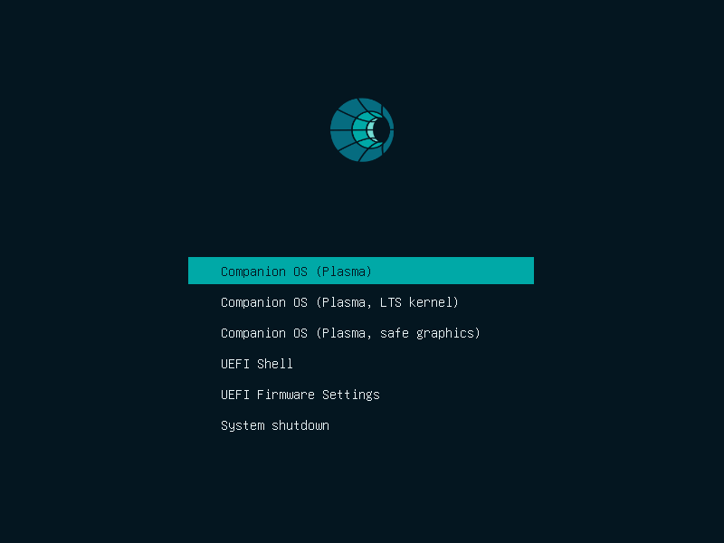
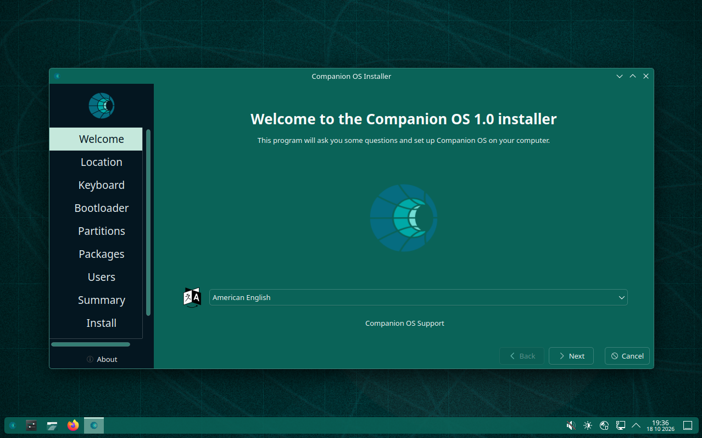
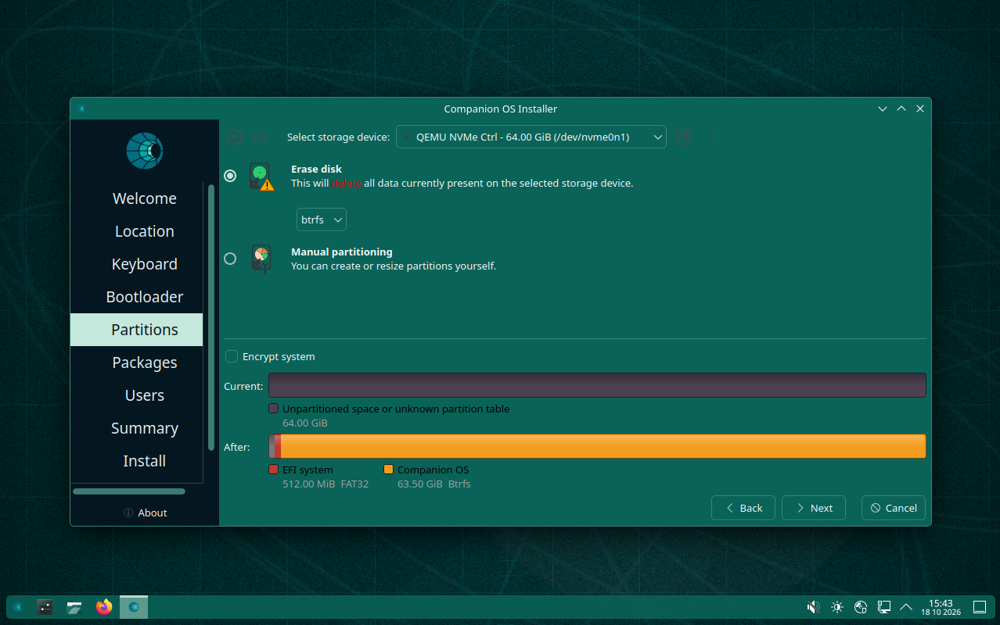
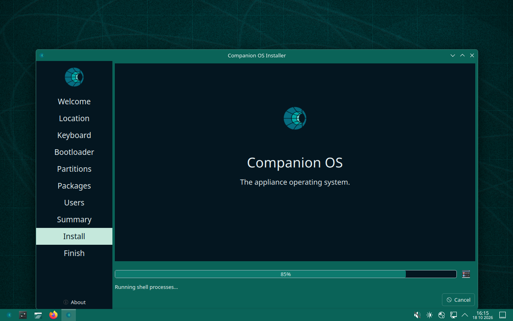
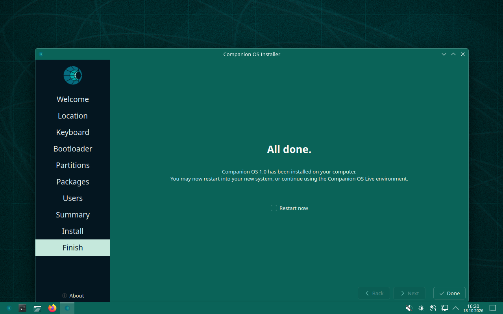
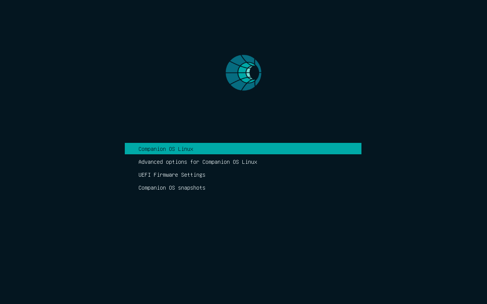
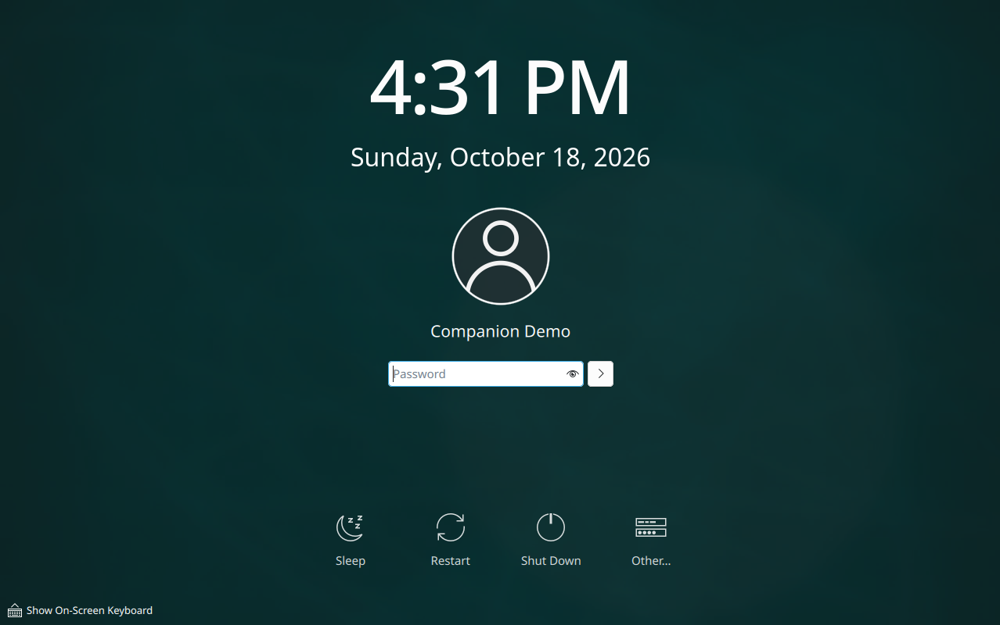
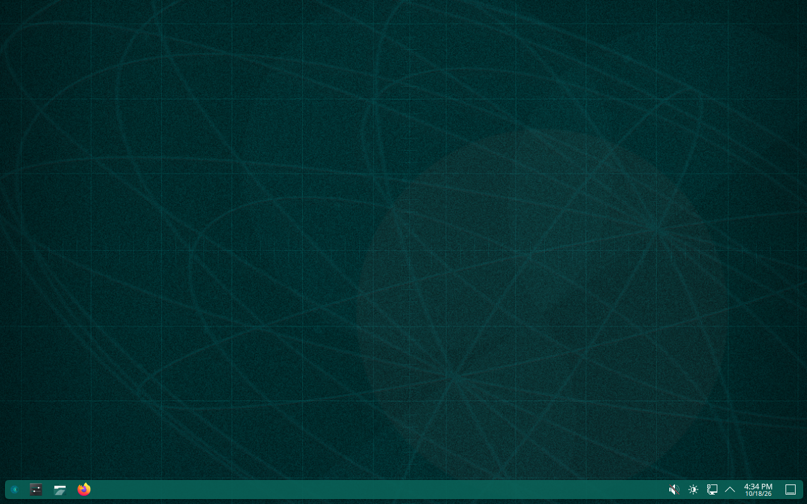
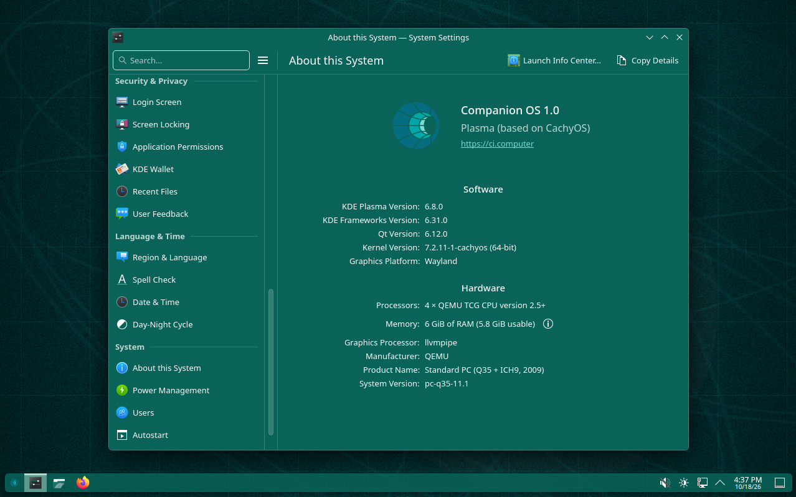
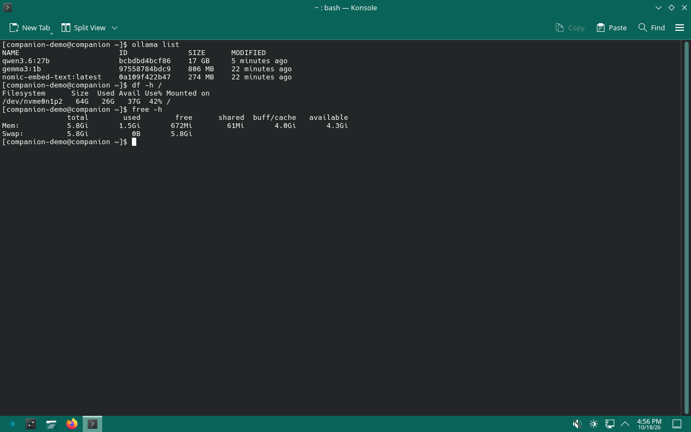

# Companion OS installation guide

Private & Confidential. Property of Lifescope Inc. Do not distribute.

Installing Companion OS on a computer, step by step, for both supported editions: Companion OS on Ubuntu 26.04.1 LTS and Companion OS on CachyOS (the "Plasma" edition). Retired 2026-10-17: Ubuntu 24.04, Linux Mint, Fedora, Bazzite, NixOS (restore from the tag `pre-retire-multidistro-2026-10-17`); there is no install path for them.

**What has been proven.** Evidence tags: **[V]** verified in a run, **[I]** implemented and unit-tested, not proven end to end, **[N]** not checked. Both editions were run under QEMU on an Apple-silicon Mac only; no physical machine has booted either (known issue KI-17). Every Plasma figure below comes from virtual machines under software emulation, and the ISO #6 figures from a single run.

| Part | Plasma edition | Ubuntu 26.04.1 edition |
|---|---|---|
| ISO built and checked | [V] verifier run on ISO #6: 215 passed, 0 failed ([log](../evidence/2026-10-18-plasma-iso6/verify.log)); 187 passed on ISO #2; ISO #4 and #5 built, no verifier log kept | [V] built from a clean checkout in 12 min 52 s, `verify-iso.sh` 393 passed, 0 failed |
| Live boot | [V] first frame 4 to 5 minutes after Enter in GRUB under emulation on a quiet host; 5 min 08 s, settled after 6 min 38 s, on a busy one (ISO #6) | pending |
| Install | [V] Calamares to an installed system on ISO #4, #5 and #6 (22 to 28 minutes; ISO #6 on its first attempt in 28 min 26 s; ISO #5 needed three attempts, see Troubleshooting) | pending (both the one-click and the interactive path) |
| Installed boot and first boot | [V] greeter 1 min 32 s after Enter in GRUB and a desktop about 70 seconds after the login (ISO #6); first-boot provisioning finished cleanly in 21 min 19 s (ISO #6; 21 min 49 s on ISO #5) | pending |

The pending rows are listed with their proofs in [test-evidence.md](../architecture/test-evidence.md). Read the steps for the Ubuntu edition as the designed behaviour, confirmed against the code and the 26.04.1 installer but not yet on screen.

## Contents

1. [Choose an edition](#choose-an-edition)
2. [Requirements](#requirements)
3. [Get and verify the ISO](#get-and-verify-the-iso)
4. [Write the USB stick](#write-the-usb-stick)
5. [Boot it](#boot-it)
6. [Install the Ubuntu edition](#install-the-ubuntu-edition)
7. [Install the Plasma edition](#install-the-plasma-edition)
8. [First boot](#first-boot)
9. [Connecting a headless machine: the setup hotspot](#connecting-a-headless-machine-the-setup-hotspot)
10. [Models](#models)
11. [Recovery and maintenance](#recovery-and-maintenance)
12. [Troubleshooting](#troubleshooting)

## Choose an edition

| | Ubuntu 26.04.1 edition | Plasma edition |
|---|---|---|
| Desktop | GNOME 50 (Ubuntu's Wayland session, named Companion OS) | KDE Plasma 6 |
| Installer | Canonical's installer, plus a one-click automatic install | Calamares, online |
| Install needs internet | No for the copy; yes for the first-boot setup | **Yes** (the welcome page requires it) |
| Secure Boot | Works with Secure Boot on (Canonical's signed chain is kept) | **Turn Secure Boot off**: not supported |
| Boots from the Companion Stick | Yes | No (the Stick's menu cannot start it) |
| Ollama after install | Installed and enabled | Installed, enabled by the first-boot setup |
| Best for | Machines with Secure Boot, Stick users, AMD Strix Halo (the boot-parameter and ROCm helpers are here) | A current rolling-release base; machines where Secure Boot can be off |

If in doubt, take the Ubuntu edition. Its limits and open decisions are in [known-issues-and-decisions.md](../architecture/known-issues-and-decisions.md).

## Requirements

| | Minimum | Recommended | Notes |
|---|---|---|---|
| CPU | 64-bit x86 (Intel or AMD) | | Booted only under emulation so far |
| Memory | 4 GB (Plasma's installer requires 2.5 GB free) | 8 GB or more; 32 GB for the largest local model | The QEMU runs used 4 to 6 GiB |
| Disk | 32 GB | **64 GB or more** | See the next paragraph |
| Firmware | UEFI | UEFI | Every run used UEFI. The Plasma ISO also carries a BIOS boot menu; the Ubuntu ISO inherits the stock BIOS and UEFI boot records [I] |
| Network | Ethernet or Wi-Fi | | Plasma: required during the install. Both: needed on first boot to provision |
| USB stick | larger than the ISO | 16 GB | The Ubuntu ISO is about 7.1 GB (an 8 GB stick is marginal), the Plasma ISO 3.2 GB |
| Display | 1280 by 800 | | The captured frames were 1280 by 800 |

**Disk size.** The system takes about 8 GiB after install (7.8 GiB on a 30 GiB disk, 8.2 GiB on a 64 GiB disk; Plasma) and the default model set adds about 18.8 GB: `nomic-embed-text` 0.27 GB, `gemma3:1b` 0.81 GB and `qwen3.6:27b` 17.8 GB. On a 30 GiB target the Plasma edition ended 88 percent full (26 GiB used), and nothing checks free space before a pull, so a smaller disk fails a model download (KI-01). On the Ubuntu edition the 17.8 GB model is pulled only on supported Strix Halo-class hardware; elsewhere only the two small models. The one-click installer accepts disks from 25 GB, which is too small for the system plus the large model.

**Hardware.** x86-64 only. Wi-Fi, graphics and suspend behaviour on real hardware are untested. AMD GPU support: the Ubuntu edition installs ROCm from the Ubuntu 26.04 archive with the kernel's inbox driver on supported Strix Halo-class machines (Ryzen AI Max, at least about 32 GB); the Plasma edition has no equivalent boot parameters (KI-03).

## Get and verify the ISO

**No Companion OS ISO has been published yet.** Where ISOs will be hosted and who signs them are open decisions (KI-12). Until then, build one ([ISO build guide](iso-build-guide.md)) or take one from the person who built it, together with its checksum file.

| Edition | File | Checksum file |
|---|---|---|
| Ubuntu | `companion-os-<version>-amd64.iso` | `SHA256SUMS` (and `SHA256SUMS.gpg` when signed) |
| Plasma | `companion-os-plasma-<YYYY.MM.DD>-x86_64.iso` | `companion-os-plasma-<YYYY.MM.DD>-x86_64.iso.sha256` |

Verify before you write it:

```bash
# Linux
sha256sum -c SHA256SUMS                                   # expect: companion-os-1.0-amd64.iso: OK
sha256sum -c companion-os-plasma-2026.10.18-x86_64.iso.sha256

# macOS
shasum -a 256 -c SHA256SUMS
```

```powershell
# Windows PowerShell: compare the printed hash with the checksum file
Get-FileHash .\companion-os-1.0-amd64.iso -Algorithm SHA256
```

A signature, when there is one, is checked against the published release key (which does not exist yet):

```bash
gpg --verify SHA256SUMS.gpg SHA256SUMS
```

**Is it the current base?** An Ubuntu-edition ISO must say 26.04.1; an image from the retired 24.04 baseline must not be installed or published:

```bash
bsdtar -xOf companion-os-1.0-amd64.iso .disk/info         # macOS, or Linux with libarchive-tools
# 7z e -so companion-os-1.0-amd64.iso .disk/info          # the same, with 7-Zip
```

The first line must start with `Companion OS 26.04.1 LTS`. A Plasma ISO is a rolling release: if it is more than a few weeks old the installer can fail because the package repositories have moved on (the launcher then says to download a newer ISO).

## Write the USB stick

**This erases the stick.** Check the device name twice.

### Linux

```bash
lsblk                                                      # find the stick, for example /dev/sdb
sudo dd if=companion-os-1.0-amd64.iso of=/dev/sdX bs=4M status=progress conv=fsync
sync
```

### macOS

```bash
diskutil list                                              # find the stick, for example /dev/disk4
diskutil unmountDisk /dev/diskN
sudo dd if=companion-os-1.0-amd64.iso of=/dev/rdiskN bs=4m
diskutil eject /dev/diskN
```

### Windows

Use Rufus and choose **DD Image** mode if it asks, or balenaEtcher. Neither was tested for this guide (**[N]**); both write hybrid ISOs raw.

### The Companion Stick (Ubuntu edition only)

`ci-stick` writes the ISO into the stick's boot slot with A/B slots, persistence and, with the signed boot files, Secure Boot. A 64 GB stick has an 8 GiB boot slot and the first Ubuntu image fits it with 1.5 GB to spare. See [stick/README.md](../../stick/README.md) (flash, with a dry run first). The Plasma ISO can be written to a stick raw, as above, but the Stick's menu cannot start it.

## Boot it

1. Insert the stick and restart. Open the firmware boot menu (commonly F12, F2, F10, Esc or Del) and choose the stick, **in UEFI mode**.
2. **Secure Boot.** Ubuntu edition: leave it on. Plasma edition: turn it off in the firmware settings first, or the firmware refuses the unsigned boot loader (this refusal is expected from the design; it was not observed because the Secure Boot variant was never tried on this edition).
3. The boot menu:

   | Edition | Entries |
   |---|---|
   | Ubuntu | "Try or Install Companion OS", **"Install Companion OS (automatic)"**, "Companion OS (safe graphics)", then "Boot from next volume" and "UEFI Firmware Settings" (UEFI). The stock menu waits 30 seconds |
   | Plasma | "Companion OS (Plasma)", "(Plasma, LTS kernel)", "(Plasma, safe graphics)", UEFI Shell, UEFI Firmware Settings, System shutdown. It starts by itself after 6 seconds |



*The boot menu of the Plasma edition live medium, with the first entry selected and the countdown stopped, captured in a virtual machine (Tested in a virtual machine).*

<!-- figure: docs/ui/companion-os/ubuntu/NN-live-grub-boot-menu.png (pending: Ubuntu edition menu with the automatic entry) -->

4. **Be patient.** Under emulation the Plasma live medium showed systemd status text, then black (about 90 seconds on ISO #4 and #5), then the desktop: 4 minutes from Enter to the first drawn frame on ISO #4 and #5, 5 min 08 s on ISO #6 on a busier host (the desktop had settled after 6 min 38 s). Real hardware should be much faster (**[N]**). The live session logs in by itself: the Plasma user is `liveuser` with passwordless `sudo`; the Ubuntu live user is `companion`.

## Install the Ubuntu edition

*Implemented and unit-tested; not yet proven end to end on a real install (known issue KI-11). The installer is Canonical's, so its own window text still says Ubuntu.*

### A. One-click automatic install

This erases **one internal disk** and installs with one question.

1. Boot the stick and choose **Install Companion OS (automatic)**. The live session starts and the dialog opens by itself. From the normal entry, click **Install Companion OS (automatic)**, which is first in the dock and in the app grid (Ubuntu 26.04's live session draws no desktop icons).
2. The dialog **names the disk**: model, size, device, and **everything found on it** (each partition and filesystem, any RAID or LUKS signature), lists the other disks that will be left alone, and shows a **one-time password** for the user `companion`. Write the password down. **Enter never confirms: the default is Cancel.**
3. With more than one internal disk you first pick one from a list; nothing is guessed.
4. Click **Erase the disk and install**. A progress window follows the installer's state and repeats the sign-in details. Choose **Cancel** or **Use the normal installer** to stop; nothing has been written before the click.
5. When it finishes the computer **turns off**. Remove the stick and turn it on.
6. Sign in as `companion` with the one-time password; the system forces a new password at the first sign-in.

What it decides for you: language `en_US.UTF-8`, keyboard `us`, time zone from GeoIP (UTC when offline), erase the chosen disk, no proprietary drivers or codecs, security updates only, host name `companion-os`, no installer self-update.

What it refuses: the disk it booted from, the stick, any disk that carries a Companion Stick label, USB, SD and removable disks, read-only disks, and disks under 25 GB. If it cannot work out where it booted from, it offers no disk and sends you to the normal installer. The safety rules and their tests are in [one-click-install.md](../architecture/one-click-install.md).

<!-- figure: docs/ui/companion-os/ubuntu/NN-install-one-click-confirmation.png (pending: the confirmation naming the disk) -->

### B. Interactive installer

1. Choose **Try or Install Companion OS**. Canonical's installer opens in the live session; if you closed it, start it again from the dock.
2. Follow Canonical's pages: language, keyboard, network, updates and applications, the type of installation, disk, account (name, computer name, user, password), time zone, review. The page order was seen on the retired 24.04.5 image; the 26.04.1 snap is a newer revision, so the pages may differ (**[N]**, frames pending).
3. Choose **Erase disk and install** unless you are partitioning by hand (dual boot and manual partitioning are possible here and not in the automatic path). Recommended manual layout: an EFI partition of 512 MB (FAT32), `/` of at least 50 GB, the rest for `/home`, swap if you want hibernation.
4. Wait for the installation, then restart and remove the stick. The retired baseline took hours under emulation; the time on real hardware is unmeasured.

## Install the Plasma edition

*Tested in a virtual machine (QEMU, software emulation, not real hardware): an install from a fresh boot with nothing done by hand on ISO #4, #5 and #6. ISO #6 installed on the first attempt.*

1. Boot the stick (Secure Boot **off**), choose **Companion OS (Plasma)**, and wait for the desktop.
2. **Make sure the computer is online.** The installer is an online installer: it downloads the system with `pacstrap` and the package groups, and the welcome page requires an internet connection (it checks `https://example.com`). Connect with the network icon in the panel.
3. Open the application menu and start **Install Companion OS** (there is no desktop icon). A launcher prepares the keyring, syncs the package databases, checks the installer against the guards and preflights every package; this takes about 3 minutes. If a step fails it shows a dialog and does not start the installer (nothing has been changed).
4. Calamares opens at **Welcome** ("Welcome to the Companion OS 1.0 installer"). Pages, in order:

   | Page | What to do |
   |---|---|
   | Welcome | Choose the language. The page shows no requirements list when everything is met: the launcher's log reported 7 of 7 requirement checks satisfied before the window opened |
   | Location | The map and zone are preselected from a GeoIP lookup; correct them if wrong (if the lookup fails the zone falls back to New York) |
   | Keyboard | Choose the layout |
   | Bootloader | GRUB is the only choice |
   | Partitions | **Erase disk** (btrfs by default, a 512 MiB EFI partition and the rest as the system) or manual. A previous failed attempt leaves the disk partitioned and adds extra choices |
   | Packages | Defaults are fine (only "Firefox and language package" is ticked) |
   | Users | Name, user name, computer name, password. "Use the same password for the administrator account" is ticked by default |
   | Summary | Check the plan, then **Install**, then confirm "Continue with Installation?" |
   | Install | 47 jobs behind a progress bar and a slideshow. 22 to 28 minutes on emulation with fast mirrors (28 min 26 s on ISO #6, host load 9 to 13) |
   | Finish | "All done." **Restart now** is unticked by default: tick it, or restart yourself, and remove the stick |



*The first page of the Plasma installer, started from the live session, captured in a virtual machine.*



*The Partitions page with Erase disk chosen; the only drive is a 64 GiB virtual NVMe disk, captured in a virtual machine. The selected option has a ring-and-dot radio button but no row highlight (KI-09).*



*The Install page at 85 percent, near the end of the run, captured in a virtual machine.*



*The Finish page, with Restart now unticked as it is by default, captured in a virtual machine.*

5. The installer takes the whole chosen disk. There is no one-click mode, no offline mode and no desktop chooser for this edition.

## First boot

### Plasma edition

GRUB shows "Companion OS Linux", "Advanced options for Companion OS Linux", "UEFI Firmware Settings" and "Companion OS snapshots", and on ISO #6 nothing else: the firmware leftovers of a virtual machine (UiApp, an EFI shell, the disk itself) no longer became menu entries. A splash and the Plasma Login Manager greeter follow (107 to 113 seconds from power-on to the greeter under emulation on ISO #4 and #5; 1 min 32 s from Enter in GRUB on ISO #6); sign in with the account you made. The splash reads "COMPANION INTELLIGENCE" (the company lockup), not "Companion OS" (KI-08). The greeter starts on a clock page and shows the password prompt after a key press. The desktop is Plasma with the Companion theme; there is no welcome app and no update notifier. **About This System** says "Companion OS 1.0, Plasma (based on CachyOS)".



*The boot menu of the installed Plasma edition, with the countdown stopped, captured in a virtual machine.*



*The sign-in screen of the installed Plasma edition, captured in a virtual machine. The account is a throwaway test account made for the capture.*



*The first desktop of the installed Plasma edition, with no welcome window, captured in a virtual machine. First-boot setup was running in the background at this moment.*



*About this System on the installed Plasma edition; the hardware lines show the virtual machine it ran in.*

**First-boot provisioning** starts by itself (`ci-os-first-boot-setup.service`) as soon as the machine has a network: Docker is installed already; it sets up Ollama, the other tools and pulls the models. With a fast connection it took **16 to 22 minutes** for the three models on the test machine (16 min 5 s on ISO #4, 21 min 49 s on ISO #5, 21 min 19 s on ISO #6). It runs in the background at low priority: the graphical target was reached 38 seconds (ISO #5) and 44 seconds (ISO #6) into userspace with the run in progress, and the desktop is usable from the first login (about 70 seconds after the login under emulation on ISO #6). Without a network it waits about 3.5 minutes, exits quietly and tries again every 15 minutes, up to three automatic runs.

```bash
systemctl status ci-os-first-boot-setup                  # running, or inactive when finished
cat /var/lib/ci-os/first-boot-setup-status               # empty or "degraded: ..." with the reason
ls /var/lib/ci-os/.first-boot-setup-done                 # present once provisioning succeeded
sudo journalctl -u ci-os-first-boot-setup --no-pager -n 40
ollama list                                              # the three models when it is done
```



*The three default models are present after first-boot setup on the installed Plasma edition, captured in a virtual machine. The frame does not show the service status or the done marker.*

On the ISO #4 build provisioning always ended "degraded" although everything was installed (a `$HOME` problem) and held the boot targets for 16 minutes; both are fixed, and on ISO #5 the unit ended with exit status 0, wrote the done marker, left no status file and showed no "degraded" [V]. ISO #6 repeated that: exit 0 after 21 min 18.9 s, the marker written, all three models listed, a 301-line log [V]. A terminal on the installed system prints `Docker version 29.9.1` and `ollama version is 0.40.6`. `sudo ci-os-setup` runs it again at any time.

### Ubuntu edition

*Designed behaviour; not yet seen on a booted image.* After the installed system boots and you sign in, `ci-os-first-boot-setup.service` waits for a network (30 tries, 2 seconds apart), removes the snaps that could not be removed at build time, runs `provision.sh --tier=core` (Docker group membership, Node.js, Ollama configuration and models, the CI-Hub tools) and writes `/var/lib/ci-os/.first-boot-setup-done` on success. It runs at every boot and every 15 minutes while pending, at most three failed automatic attempts; its log is `/var/log/ci-os-first-boot-setup.log`. After it finishes, **log out and back in** for the Docker group and `PATH`.

```bash
ci-os-info                                  # the setup, Hub's address, models, disk, failed services, a pending restart, GPU, groups
sudo ci-os-setup                            # run the setup again, even if it completed
sudo ci-os-install-rocm                     # AMD Strix Halo-class machines only: ROCm from the Ubuntu archive
```

## Connecting a headless machine: the setup hotspot

A machine with no screen needs to get onto your Wi-Fi without anyone typing on it. **Both editions** ship the setup portal ("Connect Companion Core").

1. When the machine has no connectivity (no default route; it waits 45 seconds after boot for Wi-Fi to come up, then about 6 seconds of failed checks), it starts a hotspot named `Companion-Setup-XXXX`, where `XXXX` is a random suffix chosen at every boot. It needs a Wi-Fi interface that can run an access point; on a machine without Wi-Fi it logs "ERROR: no Wi-Fi interface found" every ten minutes and nothing else happens (seen on the Plasma edition).
2. Join that network from a phone or laptop. The default passphrase is a constant committed in `core/headless/payload/hostapd/hostapd-setup.conf` (the repository README, section "First boot and hotspot setup", names the file and deliberately does not repeat it); it is the same on every unit, which is a known weakness (audit item S2 in [headless-setup.md](../architecture/headless-setup.md)).
3. Open `http://192.168.99.1` (a captive-portal prompt may open it for you), enter the pairing code if the page asks for one, choose your Wi-Fi network, enter its password and submit. The device joins and stops the hotspot.

**Security.** The portal has no real authentication yet and the hotspot passphrase is public (known issue KI-02, audit items S1 and S2). Set up a new machine on a network you trust, and do not print a hotspot QR code on a device. The design that replaces it is in [headless-setup.md](../architecture/headless-setup.md). [docs/Create-headless-setup.md](../Create-headless-setup.md) is the original task prompt, not documentation of what ships.

## Models

Both editions use the same model list (`core/manifest/ecosystem.yaml`, `llm.models`): `nomic-embed-text`, `gemma3:1b`, `qwen3.6:27b`.

| Model | Size | Notes |
|---|---|---|
| `nomic-embed-text` | 0.27 GB | Embeddings |
| `gemma3:1b` | 0.81 GB | Small chat model |
| `qwen3.6:27b` | 17.8 GB | Pulled on the Plasma edition regardless of the machine (the hardware-fit gate has no data there, KI-01); on the Ubuntu edition only on supported Strix Halo-class hardware |

```bash
ollama list                       # what is installed
ollama run gemma3:1b              # try one
df -h /                           # check the free space after the pulls
```

A pull that fails for lack of space leaves a partial download; free space and run `sudo ci-os-setup` to resume. Models on a Companion Stick's cache are managed with `ci-stick models` ([stick/README.md](../../stick/README.md)).

## Recovery and maintenance

- **A first-boot run keeps failing.** Read `/var/log/ci-os-first-boot-setup.log` (Ubuntu) or `journalctl -u ci-os-first-boot-setup` (Plasma), fix the cause (network, disk space), then `sudo ci-os-setup`.
- **The Plasma system will not boot after an update.** The GRUB entry **Companion OS snapshots** boots a Btrfs snapshot; the install takes one called "Fresh Companion OS Installation".
- **Reinstall.** Boot the stick again and repeat the install; both installers erase the target disk. Back up first.
- **Boot problems after install.** If the machine does not boot from the disk, check the firmware boot order and that the boot mode (UEFI) matches the install. On the Ubuntu edition try disabling Secure Boot only to find out whether it is the cause.
- **Updates.** Ubuntu edition: `sudo apt update && sudo apt upgrade`. Plasma edition: `sudo pacman -Syu` (a rolling release: update regularly, and read the pacman output before confirming).
- **Telemetry.** The Ubuntu edition removes `ubuntu-report`, `popularity-contest`, `apport` and `whoopsie` and blocks the metrics hosts in `/etc/hosts`. Both editions ship no host firewall that blocks the setup portal; the Ubuntu edition has `ufw` installed but disabled.

## Troubleshooting

### Plasma edition

| What you see | What it means and what to do |
|---|---|
| Welcome page: internet requirement not met | The installer needs the internet (`https://example.com` is the check). Connect, then click **Back** and **Next** or restart the installer |
| Dialog: "The package signing keys on this live system could not be set up or verified. This is a problem with the keys, not with your internet connection." | A keyring failure. Restarting does not help (the live system rebuilds the same keys). Make sure the computer is online (it sets its clock from the internet) and start the installer again; if it keeps failing the ISO is older than the keys the repositories use now: download a newer ISO |
| Dialog: "The package repositories could not be reached, or a mirror did not have the files it should." | Network or mirror problem. Check the connection and try again in a few minutes |
| Dialog: "The package repositories could not be updated. Try again in a few minutes." | An unclassified pacman error; the launcher log has pacman's exact last error line: `/home/liveuser/companion-install.log` |
| "The installer was NOT started (nothing was changed on your disks)" | A guard or the package preflight failed closed. Try later or use a newer ISO |
| "Installation Failed: command `bash /etc/calamares/scripts/create-pacman-keyring` failed to finish in 30 seconds" (at about 2 percent) | A defect of ISO #5 and older (KI-20): the keyring step had a 30 second limit (Calamares' default; the installer set no `timeout`) and slow machines exceeded it. Click Close, start **Install Companion OS** again; it passed on the third attempt in the run that hit it. The disk now holds a failed attempt's partitions: choose Erase disk again. Fixed in commit `ad37b64`: on ISO #6 the same step took 32 seconds and the install passed on the first attempt, in one run in a virtual machine [V] |
| `calamares` exits at once with `error while loading shared libraries: libboost_python314.so.1.91.0` | The ISO is older than the repositories' libraries and its compatibility libraries are missing: use a newer ISO (the build now stops on this) |
| Status line "Installing needed drivers for CachyOS..." during the install | Upstream's label on ISO #5 and older (KI-08); harmless. ISO #6 says "Installing needed drivers for Companion OS..." |
| Status line shows pacman text that names CachyOS packages ("Updating CachyOS specific configuration.", "pacman: installing cachyos-alacritty-config...") for a few seconds | Raw output of the package manager during the `pacstrap` and `packages` jobs; harmless and still present on ISO #6 (KI-08) |
| Log lines "Could not inhibit sleep", "chcon" not found, "Unit X does not exist" | Harmless; seen in every successful install |
| Black screen for about 90 seconds on the live medium | Normal under emulation: the live medium has no boot splash. Wait. If the display stays black, try the "safe graphics" entry |
| After the install, `ollama --version` prints two "no server" warnings | `ollama.service` is enabled by the first-boot setup (KI-07); it goes away when provisioning finishes |
| `systemctl is-system-running` says `degraded` on the live medium | One failed unit, `systemd-time-wait-sync.service`; not user-visible |

### Ubuntu edition

| What you see | What it means and what to do |
|---|---|
| Automatic dialog: "No internal disk of at least 25 GB was found." (with what was left out) | The disk is too small, removable, on USB or SD, or is the boot medium. Use the normal installer, or a bigger internal disk |
| "The disk this session started from could not be identified, so no disk is offered." | The helper fails closed. Use the normal installer |
| "An installation is already running, or an earlier one left the new system mounted at /target." | Nothing was changed. If nothing is installing, restart from the stick and try again |
| "The automatic install did not finish: ..." with "Nothing was erased." or "The disk may be partly or completely erased." | Read the sentence: it says whether the install was confirmed. Details are in `/var/log/installer/`. The message says "from the desktop icon", but the 26.04 live session draws no desktop icons: use the stock installer in the dock |
| An installed system stops at "Unable to find a medium containing a live file system" | A defect of the retired 24.04 baseline (live-only content reached the installed layer). The 26.04.1 build splits the layers and tests for it; if you see it, report the ISO file name and sha256 |
| The machine does not boot from the stick with Secure Boot on | Check the boot mode is UEFI; check the ISO sha256; try "safe graphics". Do not disable Secure Boot as a first step |
| First-boot setup never completes | Read `/var/log/ci-os-first-boot-setup.log`; "Network not available after 60s" means it will retry; `sudo ci-os-setup` runs it again |
| After the first boot, Docker needs `sudo` | Log out and back in (or `newgrp docker`) so the group change applies |
| No Wi-Fi, no Bluetooth or no sound | Untested on real hardware. `sudo apt install linux-firmware` and `sudo reboot` first; report the hardware (`lspci`, `lsusb`) |

### Reporting a problem

Report on GitHub with the ISO file name and sha256, the edition, what you did, and the output of:

```bash
cat /etc/os-release
uname -a
lscpu | head -20
sudo journalctl -b --no-pager | tail -200
```

Do not post a password, a token or a one-time sign-in password. Issues: https://github.com/companionintelligence/CI-OS/issues.

© Companion Intelligence, Lifescope Inc
