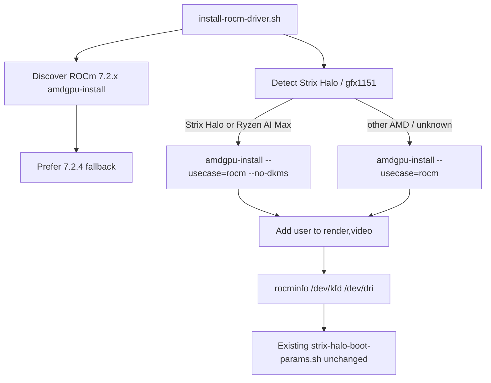

# Strix Halo ROCm for Companion Ubuntu

## Context

`ci-os` is **Companion Ubuntu** — a set of post-install / provisioning scripts (plus an unused-in-practice ISO path), not a shipped OS. Changes should focus on the scripts people actually run (`install-rocm-driver.sh`, setup hooks, docs), not ISO polish.

## Version reality (researched against repo.radeon.com + AMD docs)

- There is **no ROCm 7.3** on AMD’s apt/`amdgpu-install` index.
- Newest Ryzen-compatible line on Ubuntu 24.04 noble: **ROCm 7.2.4**  
  `https://repo.radeon.com/amdgpu-install/7.2.4/ubuntu/noble/amdgpu-install_7.2.4.70204-1_all.deb`
- Official Strix Halo / Ryzen install requires **`--no-dkms`** (inbox `amdgpu` kernel driver). DKMS is the wrong path for gfx1151.
- AMD’s Strix Halo matrix marks **7.2.1 / 7.2.2 / 7.2.3** as stable with a new enough kernel (Ubuntu 24.04 HWE ≥ `6.17.0-19…` or OEM ≥ `6.14.0-1018`). 7.2.4 is the newest package in that same 7.2.x track.
- ROCm **7.14** exists in mainline docs but has **no** `amdgpu-install/7.14` repo path; Ryzen docs still point at the 7.2.x installer. Do **not** chase 7.14 for this script.
- Current discovery bug: probing “newest” `amdgpu-install/` picks **31.40** (Radeon graphics driver line), not ROCm 7.2.x. That must be fixed.

## Target behavior

## Code changes

### 1. Primary: [`scripts/install-rocm-driver.sh`](ci-os/scripts/install-rocm-driver.sh)

- Bump fallback to **7.2.4**:
  - `FALLBACK_AMDGPU_LINE="7.2.4"`
  - `FALLBACK_AMDGPU_DEB="amdgpu-install_7.2.4.70204-1_all.deb"`
- Fix discovery so it only considers **ROCm 7.x** installer lines (href matching `7.*`), newest first — never 30.x/31.x graphics lines.
- Source [`scripts/lib/gpu-detect.sh`](ci-os/scripts/lib/gpu-detect.sh) early.
- **Strix Halo / Ryzen AI Max path** (when `is_strix_halo_from_system` or equivalent matches):
  - Run `amdgpu-install -y --usecase=rocm --no-dkms`
  - Do **not** require or install `amdgpu-dkms` for “already satisfied”
  - If DKMS was previously installed, warn and prefer removing it (`amdgpu-dkms` / `dkms`) per AMD Ryzen docs
  - Warn (do not auto-switch kernels) if running kernel looks older than AMD’s Strix Halo minimums
- **Non-Strix path**: keep `amdgpu-install -y --usecase=rocm` (DKMS allowed) but still use the 7.2.4 discovery fix.
- Update header comments to say Companion Ubuntu provisioning for Strix Halo / gfx1151.

### 2. Docs / messaging (light)

- [`README.md`](ci-os/README.md): clarify Companion Ubuntu scripting (not a proper OS); ROCm helper targets **7.2.4** + Strix Halo `--no-dkms`.
- [`docs/guides/quick-start-guide.md`](ci-os/docs/guides/quick-start-guide.md) / [`docs/guides/installation-guide.md`](ci-os/docs/guides/installation-guide.md): same version + Strix Halo note if they already mention ROCm.
- Workflow release blurb in [`.github/workflows/build-companion-os-iso.yml`](.github/workflows/build-companion-os-iso.yml): `ROCm 7.2+` → `ROCm 7.2.4` (ISO remains secondary).

### 3. Leave alone unless needed

- [`scripts/lib/strix-halo-boot-params.sh`](ci-os/scripts/lib/strix-halo-boot-params.sh) — already correct; keep as post-ROCm hook.
- ISO chroot (`customize-chroot.sh`) — only ships the helper; no ISO rebuild work.

## Out of scope

- Building or shipping the ISO
- Installing OEM/HWE kernels automatically
- ROCm 7.14 / TheRock nightlies
- PyTorch wheel pins

## Verification (manual on hardware or dry-run)

- Probe logic prints `7.2.4` / `amdgpu-install_7.2.4.70204-1_all.deb` for noble.
- On Strix Halo: install command includes `--no-dkms`; `rocminfo` shows `gfx1151`.
- On non-Strix: still installs via `usecase=rocm` without forcing `--no-dkms`.
